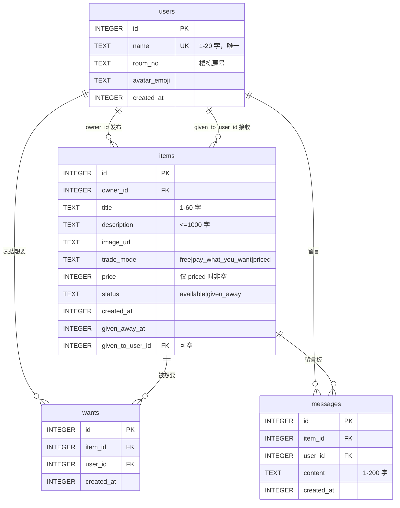

# 「隔壁」小区闲置流转 — 开发文档

> 24 小时 AI Coding 实战考试 · 求职笔试版
> ⏱️ **剩余时间不足 12 小时** → 本文档已按「12 小时极限版」重排优先级
> ✅ 4 项决策已确认（见 §12）→ 可直接开工

> **本文档的用法（重要）**
> 这份文档要交给**执行 AI**（GPT / Cursor / Trae / Codex 等）来落地代码。人类只做决策和验收。
> - **§1–§13** 是设计规格 —— 执行 AI 的**唯一事实来源**，所有接口、表结构、Prompt 都已定稿
> - **§14** 是给执行 AI 的工程规范（项目结构、禁止事项、运行命令）
> - **§15** 是 11 张任务卡 —— **执行 AI 一次只做一张，做完停下等人类确认**
> - **§16** 是交付前人类自检项
> 交给执行 AI 时，请把 **§14.1 的开工指令**连同本文档一起发过去。
>
> **配套工具（人类自建，位于 `monitor/`，执行 AI 不要改动）**
> ```bash
> python monitor/verify.py --card 3    # 自动验收第 3 张卡，输出真实的通过/失败
> python monitor/verify.py             # 全量验收 11 张卡
> python monitor/server.py             # 在线进度看板 → http://127.0.0.1:8787
> ```
> 它们的作用：**不采信 GPT 口中「已完成」这四个字，只采信真实跑出来的结果。**

---

## 0. 一页纸摘要

| 项 | 内容 |
| --- | --- |
| 产品名 | **隔壁** — 楼里的闲置流转（副标题沿用题目原话：*让闲置在沉没之前被看到*） |
| 形态 | 移动端优先的 Web App（业主群场景 = 手机），PC 上居中呈现 |
| 架构 | 前后端分离：React + Vite → FastAPI → SQLite |
| 数据表 | **4 张**：users / items / wants / messages |
| 接口数 | 16 个（图片上传已砍，见 §1.2） |
| LLM | 写成 `.env` 配置项（**先不填**）；你系统里已有 `DASHSCOPE_API_KEY` 可直接用；**全部带降级兜底** |
| 视觉 | 珊瑚橙 `#FF6B35` + 暖白 `#FAF7F2`，移动端优先 |
| 交付物 | 5 分钟视频 + ER 图 + 技术栈简介 |
| 最重风险 | 时间不够 → 用「垂直切片」策略保证任何时刻都有可演示的东西 |


### 0.1 12 小时版的三条铁律

**铁律一：垂直切片优先，不做"先写完后端再写前端"。**
每完成一个功能，都必须是从数据库 → 接口 → 界面**全通**的一条。跑通一条就录一条。这样即使时间用光，你手上也是一个能演的东西，而不是半截后端。

**铁律二：砍功能，不砍打磨。**
考试原文写着"功能不求完整，但 UX 须顺滑"。宁少做一个功能，也不能让界面粗糙。**UX 打磨的 45 分钟不许挪用。**

**铁律三：LLM 的 fallback 就是主路径。**
因为你选择"先不填 key"，所以**规则兜底版必须写得足够好，好到不填 key 也能演**。同时——**你系统环境变量里已经有 `DASHSCOPE_API_KEY`，录屏前把它填进 `.env` 就能用真 LLM，零注册零充值。** 两条路都留着。

**六个核心决策（也是视频里的"决断力"话术）**

1. 不做登录 → 输名字即进入 + `X-User-Id` 头。熟人场景不需要密码，且视频里能演完整"进入"流程。
2. `trades` 表折叠进 `items` → 1:1 表是设计坏味道，且**只有同一行才能用 CHECK 约束"成交时间不早于发布时间"**。
3. 时间统一存 **epoch 整数秒** → 不用 `CURRENT_TIMESTAMP`（UTC 文本无时区标记），算术就是相减，免疫时区坑。
4. 新鲜度**不入库** → 它是 `created_at` 的纯函数，落库必与真实时间漂移。
5. 后端**全用同步 `def`** → 跑在线程池，LLM 卡 20 秒只占一个线程，不冻结服务。
6. 不装 shadcn/ui、不装 TanStack Query → 手写 Tailwind 组件 + 20 行 `useApi`；依赖越少，越能当场解释。

---

## 1. 产品定义

### 1.1 一句话定位

给小区/楼栋内部用的极轻量闲置流转工具。**不是二手交易平台，是"楼道公告板"的数字化**。

三条产品原则（砍功能的依据都来自这里）：

- **不需要信用体系** —— 都是熟人，不做评价/举报/实名
- **不需要物流** —— 都在隔壁楼，只做"自提"
- **唯一目标是"被看到"** —— 所以新鲜度标识和卡片流优先于一切

### 1.2 功能清单与优先级

| 模块 | 功能 | 优先级 | 说明 |
| --- | --- | --- | --- |
| 身份 | 预置住户列表 | P0 | seed 6 个住户 |
| 身份 | 输名字即注册（无密码） | P0 | 约 25 分钟，演示价值高 |
| 身份 | 顶部切换身份 | P0 | 存 localStorage |
| 发布 | 名称 / 描述 / 交易方式 / 价格 | P0 |  |
| 发布 | **占位图**（title hash → 渐变色块 + 品类 emoji） | P0 | **取代图片上传** |
| 发布 | 图片上传 | **CUT** | 12 小时版直接砍，省 1 小时；视频里主动讲"我砍了上传，因为占位图已足够表达" |
| 发布 | 新鲜度三档标识 | P0 | 服务端算 |
| 发布 | 标记已送出（归档） | P0 | 可指定接收人 |
| 浏览 | 卡片流 + 新鲜度倒序 | P0 |  |
| 浏览 | 按交易方式筛选 | P0 |  |
| 浏览 | 关键词搜索 | P0 | LIKE 转义必做 |
| 浏览 | 在售 / 已送出 / 我的 三个 tab | P0 |  |
| 浏览 | 详情页 | P0 |  |
| 浏览 | 分页 | **CUT** | 数据量小，不做；接口留 `limit` 上限即可 |
| 互动 | 点"想要" / 取消 | P0 | 幂等 + 唯一约束 |
| 互动 | 想要人数展示 | P0 |  |
| 互动 | 发布者看"谁想要" | P0 | 仅 owner 可见 |
| 互动 | 留言板（列表 + 发帖） | P0 |  |
| 看板 | 本月发布 / 本月成交 / 当前在售 | P0 |  |
| 看板 | 最快被领走 | P0 |  |
| 看板 | 最想要的物品 | P0 |  |
| LLM | 定价建议 | P0 |  |
| LLM | 文案优化 | P0 |  |
| LLM | FAQ 自动回复 | P0 | 带物品真实信息注入 |
| — | 登录注册/密码 | **CUT** |  |
| — | WebSocket / 实时推送 | **CUT** |  |
| — | 编辑已发布物品 | **CUT** | 只留发布 + 归档 |
| — | 删除物品 / 撤销送出 | **CUT** | 状态机越简单越不容易崩 |
| — | 消息通知 / 收藏 / 举报 / 信用分 | **CUT** |  |


### 1.3 命名与视觉身份

- 名字：**隔壁**。理由：短、有温度、直接点出"熟人邻里"这个前提，比"校园闲置""社区二手"更有辨识度。
- 副标题：让闲置在沉没之前被看到（直接引用题目，评委一眼看到你抓住了核心痛点）。
- 图标：一个门牌号造型，或直接用 emoji 🏘️。

---

## 2. 技术栈与选型理由

### 2.1 定稿

| 层 | 选型 | 版本/备注 |
| --- | --- | --- |
| 前端框架 | React + Vite + **TypeScript** | `npm create vite@latest frontend -- --template react-ts` |
| 样式 | **Tailwind CSS v4** + `@tailwindcss/vite` | v4 无配置文件，少一个出错面 |
| 路由 | `react-router-dom` | 4 个页面 |
| 图标 | `lucide-react` | 唯一引入的 UI 库 |
| 请求 | 原生 `fetch` + 自写封装 | 不用 axios |
| 状态 | `useState` + 自写 `useApi`(20 行) | 不用 TanStack Query |
| 后端 | **FastAPI（全同步 `def`）** |  |
| ORM | SQLAlchemy 2.0 声明式 | **不用 `relationship()`** |
| 数据库 | SQLite | 不用 Alembic，`create_all()` + 删库重建 |
| LLM | `openai` SDK **同步客户端** | `timeout=20` |
| 依赖 | `fastapi uvicorn[standard] sqlalchemy pydantic-settings openai python-multipart` | 上传必须 `python-multipart` |
| 运行 | `uv` 管后端 / `npm` 管前端 |  |


### 2.2 六个决策的完整理由（背下来，视频要讲）

**① 为什么不做登录？**
场景是熟人小区，题目原文已说"不需要复杂的信用体系，因为都是熟人"。做密码系统要占 2 小时，且答辩时无法解释为什么熟人之间要输密码。改成"预置住户 + 输名字即进入"，省下的时间全投到 UX。

**② 为什么 `trades` 折叠进 `items`？**
我方原本设计了独立 `trades` 表，后否掉。因为成交与物品是**严格 1:1**（一件物品只会被送出一次），1:1 表是设计坏味道：多一次 join、且两表状态可能不一致。折叠后所有成交信息在一行，还能直接写数据库约束：
`CHECK (given_away_at IS NULL OR given_away_at >= created_at)` —— 这条"成交不可能早于发布"的规则，分表就写不出来。

> 若被追问"成交不是应该有独立流水吗"：这个场景不需要审计，如果要做（比如医疗数据那种合规场景），才会单独建成交流水表——**正好把你在医疗数据治理实习里学到的"不可篡改流水"当成对比讲出来，这是加分点**。

**③ 为什么时间存 epoch 整数秒？**
`CURRENT_TIMESTAMP` 写进去的是 UTC 文本（`"2026-09-30 03:00:00"`），读回来是 naive datetime，前后端各自加减 8 小时就会错位。存 `int(time.time())` 之后：新鲜度 = `(now - created_at)/3600`，本月边界 = 两个整数比较，**根本没有时区解析这一步**。

**④ 为什么新鲜度不入库？**
它是 `created_at` 的纯函数（派生数据）。一旦落库，就需要定时任务刷新，忘了刷新就出现"明明 5 天前发的却显示刚上架"的自相矛盾。派生数据不落库是数据库设计的基本原则。

**⑤ 为什么后端全用同步 `def`？**
FastAPI 里 `def` 会被丢进线程池（默认约 40 线程），`async def` 直接在事件循环里跑。如果在 `async def` 里调**同步**的 LLM 客户端，那个 20 秒会**阻塞整个事件循环**——期间列表、详情、健康检查全部卡死。用 `def` 则只占一个线程，其余请求照常。演示时我同时开两个页面，一个在调 AI，另一个刷新列表依然流畅——这就是证据。

**⑥ 为什么前端依赖这么少？**
不装 shadcn/ui：它要配路径别名、`cn()`、cva/tailwind-merge/clsx + 一堆 Radix 包，Tailwind v4 下还有版本适配问题；而本项目需要的 UI（卡片流、表单、详情、弹窗）用 Tailwind 全能手写。花在装配上的时间 > 手写的时间，且一旦装错会大面积白屏。
不装 TanStack Query：它的缓存/失效/后台刷新是运行时魔法，我讲不清 `queryKey` 和 `staleTime` 的行为。
**结论：依赖越少 → 出错面越小 → 越能逐行解释。** 这句话本身在面试里就是加分。

### 2.3 Tailwind v4 精确配置（照抄，别让 AI 自由发挥）

```
npm install tailwindcss @tailwindcss/vite
```

`vite.config.ts`：

```ts
import { defineConfig } from "vite";
import react from "@vitejs/plugin-react";
import tailwindcss from "@tailwindcss/vite";

export default defineConfig({
  plugins: [react(), tailwindcss()],
  server: {
    // 用 proxy 转发，前端代码里统一写相对路径 /api，免配 CORS、免硬编码后端地址
    proxy: {
      "/api": "http://127.0.0.1:8000",
      "/uploads": "http://127.0.0.1:8000",
    },
  },
});
```

`src/index.css`（**只有下面这些，不要出现 `@tailwind base`**）：

```css
@import "tailwindcss";

@theme {
  --color-brand: #ff6b35;        /* 珊瑚橙（已确认） */
  --color-brand-dark: #e85d2a;
  --radius-card: 1rem;
}
```

`src/main.tsx`：`import "./index.css";`

**AI 生成 Tailwind 代码时最容易出错的 5 处（盯死）**

1. **v3/v4 语法混用（最高频）**：AI 爱写 `@tailwind base; @tailwind components; @tailwind utilities;` —— v4 必须删掉，改成 `@import "tailwindcss";`
2. **多余创建 `tailwind.config.js`**：v4 默认不需要；存在且内容错会干扰。自定义走 `@theme`
3. **跑 `npx tailwindcss init -p`**：这是 v3 命令，v4 下会生成错东西
4. **PostCSS 包名写错**：v4 的 PostCSS 插件叫 `@tailwindcss/postcss`；本项目用 Vite 插件，**根本不需要 PostCSS 配置文件**
5. **忘了在入口 import CSS**：表现为"完全没样式"——这是"Tailwind 不生效"最常见的原因

---

## 3. 数据库设计

### 3.1 ER 图



### 3.2 DDL（可直接执行，即 ER 图的权威来源）

```sql
CREATE TABLE users (
  id           INTEGER PRIMARY KEY AUTOINCREMENT,
  name         TEXT NOT NULL UNIQUE CHECK (length(trim(name)) BETWEEN 1 AND 20),
  room_no      TEXT CHECK (room_no IS NULL OR length(room_no) <= 20),
  avatar_emoji TEXT,
  created_at   INTEGER NOT NULL
);

CREATE TABLE items (
  id               INTEGER PRIMARY KEY AUTOINCREMENT,
  owner_id         INTEGER NOT NULL REFERENCES users(id) ON DELETE CASCADE,
  title            TEXT NOT NULL CHECK (length(trim(title)) BETWEEN 1 AND 60),
  description      TEXT NOT NULL DEFAULT '' CHECK (length(description) <= 1000),
  image_url        TEXT,
  trade_mode       TEXT NOT NULL CHECK (trade_mode IN ('free','pay_what_you_want','priced')),
  price            INTEGER CHECK (price IS NULL OR price BETWEEN 1 AND 999999),
  status           TEXT NOT NULL DEFAULT 'available' CHECK (status IN ('available','given_away')),
  created_at       INTEGER NOT NULL,
  given_away_at    INTEGER,
  given_to_user_id INTEGER REFERENCES users(id) ON DELETE SET NULL,

  CHECK ((trade_mode = 'priced') = (price IS NOT NULL)),
  CHECK ((status = 'given_away') = (given_away_at IS NOT NULL)),
  CHECK (given_away_at IS NULL OR given_away_at >= created_at),
  CHECK (given_to_user_id IS NULL OR status = 'given_away')
);

CREATE TABLE wants (
  id         INTEGER PRIMARY KEY AUTOINCREMENT,
  item_id    INTEGER NOT NULL REFERENCES items(id) ON DELETE CASCADE,
  user_id    INTEGER NOT NULL REFERENCES users(id) ON DELETE CASCADE,
  created_at INTEGER NOT NULL,
  UNIQUE (item_id, user_id)
);

CREATE TABLE messages (
  id         INTEGER PRIMARY KEY AUTOINCREMENT,
  item_id    INTEGER NOT NULL REFERENCES items(id) ON DELETE CASCADE,
  user_id    INTEGER NOT NULL REFERENCES users(id) ON DELETE CASCADE,
  content    TEXT NOT NULL CHECK (length(trim(content)) BETWEEN 1 AND 200),
  created_at INTEGER NOT NULL
);

CREATE INDEX idx_items_status_created ON items(status, created_at DESC);
CREATE INDEX idx_items_owner          ON items(owner_id);
CREATE INDEX idx_items_mode           ON items(trade_mode);
CREATE INDEX idx_wants_item           ON wants(item_id);
CREATE INDEX idx_messages_item        ON messages(item_id, created_at);
```

### 3.3 四条 CHECK 不变量（答辩话术：数据自洽靠数据库，不靠前端自觉）

| 约束 | 业务含义 |
| --- | --- |
| `(trade_mode='priced') = (price IS NOT NULL)` | 标价必须有价；**免费送/随便给不许有价**（"随便给还标价就不是随便给"——这是一条明确的产品决断） |
| `(status='given_away') = (given_away_at IS NOT NULL)` | 状态与时间戳强绑定，不可能出现"已送出但没时间" |
| `given_away_at IS NULL OR given_away_at >= created_at` | 成交不可能早于发布（数据库层兜底时钟问题） |
| `given_to_user_id IS NULL OR status='given_away'` | 没送出就不该有接收人 |


### 3.4 SQLite 外键：必须手动开（重要）

SQLite **默认不强制外键**，上面所有 `REFERENCES` / `ON DELETE` 全是摆设，除非：

```python
# app/database.py
from sqlite3 import Connection as SQLite3Connection
from sqlalchemy import create_engine, event
from sqlalchemy.engine import Engine

DB_PATH = Path(__file__).resolve().parent.parent / "app.db"   # 绝对路径！见 §7.10
engine = create_engine(
    f"sqlite:///{DB_PATH.as_posix()}",
    connect_args={"check_same_thread": False},
)

@event.listens_for(Engine, "connect")
def _fk_pragma_on_connect(dbapi_con, con_record):
    if isinstance(dbapi_con, SQLite3Connection):
        dbapi_con.execute("PRAGMA foreign_keys=ON")
```

**验证是否真的生效**（做完必测一次）：手动插一条 `owner_id=999` 的物品，必须报 `FOREIGN KEY constraint failed`。不报就是没开。

> 若在 Python 3.12+ 上发现 PRAGMA 不生效，是因为 sqlite3 的事务控制变了，需临时设 `dbapi_con.autocommit = True` 执行 PRAGMA 再改回。

### 3.5 月边界与时区

**全项目只有一个口径：Asia/Shanghai 的自然月，且只在服务端算一次。**

```python
from datetime import datetime, timezone, timedelta
CN = timezone(timedelta(hours=8))

def month_range_epoch() -> tuple[int, int]:
    now = datetime.now(CN)
    start = now.replace(day=1, hour=0, minute=0, second=0, microsecond=0)
    nxt = (start.replace(year=start.year + 1, month=1) if start.month == 12
           else start.replace(month=start.month + 1))
    return int(start.timestamp()), int(nxt.timestamp())
```

发布数用 `items.created_at`，成交数用 `items.given_away_at`，**两者共用同一对边界**。
⚠️ 绝不要在 SQL 里对时间做 `strftime('%Y-%m')` 分组——那会与上面的本地月边界打架（月初月末各差 8 小时）。

---

## 4. API 接口契约

### 4.1 通用约定

| 项 | 约定 |
| --- | --- |
| 前缀 | `/api` |
| 身份 | 请求头 `X-User-Id: <int>`；**读接口匿名放行，写接口缺失/非法 → 401** |
| 时间 | 一律 **epoch 整数秒** |
| 金额 | 一律 **整数元**（避免浮点误差） |
| 错误体 | `{"detail": "中文说明"}` |
| 列表体 | `{"items": [...], "total": N}` |
| LLM 接口 | **失败也返回 200**，用 `source:"llm"\ | "fallback"` 区分（见 §6.3） |


### 4.2 接口总表（16 个）

**身份**

| # | Method | Path | 请求 | 响应 | 状态码 |
| --- | --- | --- | --- | --- | --- |
| 1 | GET | `/api/users` | — | `[{id,name,room_no,avatar_emoji}]` | 200 |
| 2 | POST | `/api/users` | `{name, room_no?, avatar_emoji?}` | `{id,name,...}` | 201 新建 / 200 同名复用 / 400 |
| 3 | GET | `/api/me` | 头 | `{id,name,room_no,avatar_emoji}` | 200 / 401 |


**物品**

| # | Method | Path | 请求 | 响应 | 状态码 |
| --- | --- | --- | --- | --- | --- |
| 4 | GET | `/api/items` | `?status=available\ | given_away\ | all`（默认 available）`&trade_mode=` `&q=` `&owner=me` `&sort=fresh\ | oldest` `&limit=`（默认20，cap100）`&offset=` | `{items,total}` | 200 |
| 5 | GET | `/api/items/{id}` | — | `ItemDetail` | 200 / 404 |
| 6 | POST | `/api/items` | `{title,description?,trade_mode,price?,image_url?}` | `ItemOut` | 201 / 400 / 401 |
| 7 | POST | `/api/items/{id}/give-away` | `{to_user_id?:int}` | `ItemOut` | 200 / 400 / 401 / 403 / 404 / 409 |


**互动**

| # | Method | Path | 请求 | 响应 | 状态码 |
| --- | --- | --- | --- | --- | --- |
| 8 | POST | `/api/items/{id}/wants` | — | `{want_count, i_want:true}` | 201 首次 / **200 已存在（幂等）** / 400 自己 / 401 / 404 / 409 已送出 |
| 9 | DELETE | `/api/items/{id}/wants` | — | — | **204（不存在也 204，幂等）** / 401 / 404 |
| 10 | GET | `/api/items/{id}/wants` | 头 | `[{id,name,avatar_emoji}]` **仅 owner** | 200 / 401 / 403 / 404 |
| 11 | GET | `/api/items/{id}/messages` | — | `{messages:[...]}` | 200 / 404 |
| 12 | POST | `/api/items/{id}/messages` | `{content}` | `MessageOut` | 201 / 400 / 401 / 404 / 409 已送出 |


**看板**

| # | Method | Path | 响应 | 状态码 |
| --- | --- | --- | --- | --- |
| 13 | GET | `/api/stats` | `{this_month_published, this_month_completed, available_count, fastest:{item,took_seconds}\ | null, most_wanted:[{item,want_count}]}` | 200 |


**LLM**

| # | Method | Path | 请求 | 响应 | 状态码 |
| --- | --- | --- | --- | --- | --- |
| 14 | POST | `/api/llm/price-suggest` | `{title, description?}` | `{source, mode:"priced"\ | "free", min, max, reason}` | 200 |
| 15 | POST | `/api/llm/polish` | `{title, description}` | `{source, title, description}` | 200 |
| 16 | POST | `/api/llm/faq-reply` | `{item_id, question}` | `{source, reply}` | 200 / 404 |


**上传 —— 已砍（12 小时版不做，占位图代替；如时间富余可加回）**

| # | Method | Path | 请求 | 响应 | 状态码 |
| --- | --- | --- | --- | --- | --- |
| ~~17~~ | ~~POST~~ | ~~`/api/upload`~~ | `multipart/form-data: file` | `{url:"/uploads/<uuid>.png"}` | 200 / 400 / 401 / 413 |


`ItemOut`：`id, title, description, image_url, trade_mode, price, status, owner:{id,name,room_no,avatar_emoji}, created_at, given_away_at, given_to_user_id, want_count, freshness:{level,label}, is_mine, i_want`

### 4.3 四个必须写对的实现细节

**① 新鲜度计算（服务端唯一实现）**

```python
def freshness(created_at: int, now: int | None = None) -> dict:
    now = now if now is not None else int(time.time())
    hours = max(0.0, (now - created_at) / 3600)   # max(0,...) 防时钟漂移出负数
    if hours < 24:
        return {"level": "fresh24", "label": "刚上架"}
    if hours < 72:
        return {"level": "fresh72", "label": "新上架"}
    return {"level": "old", "label": f"已上架{int(hours // 24)}天"}
```

- 边界定义：**恰好 24 小时** 归入"新上架"（条件是 `< 24`）；**恰好 72 小时** 归入"已上架3天"。
- 前端只渲染 `label`，不做任何时间运算 → 列表和详情永不打架。

**② LIKE 通配符转义（最容易漏，漏了搜 `%` 会命中全部）**

```python
def like_escape(s: str) -> str:
    # 顺序不能反：必须最先转义反斜杠本身
    return s.replace("\\", "\\\\").replace("%", "\\%").replace("_", "\\_")

q = (raw_q or "").strip()[:50]
stmt = select(Item).where(Item.status == "available")
if q:
    pattern = f"%{like_escape(q)}%"
    stmt = stmt.where(or_(
        Item.title.ilike(pattern, escape="\\"),
        Item.description.ilike(pattern, escape="\\"),
    ))
# 稳定排序：created_at 相同也有 id 兜底，翻页不抖
stmt = stmt.order_by(Item.created_at.desc(), Item.id.desc()).limit(limit).offset(offset)
```

> 参数化查询本身已免疫 `'`、`--`、`;` 等 SQL 注入，**只有 LIKE 的 `%`/`_` 需要上面这段**。

**③ 标记已送出必须用原子 UPDATE（防并发竞态）**

```python
now = max(int(time.time()), item.created_at)   # 防"成交早于发布"
res = session.execute(
    update(Item)
    .where(Item.id == item_id, Item.owner_id == uid, Item.status == "available")
    .values(status="given_away", given_away_at=now, given_to_user_id=to_user_id)
)
session.commit()
if res.rowcount == 0:                 # 没更新到 → 再判断具体原因
    it = session.get(Item, item_id)
    if it is None:            raise HTTPException(404, "物品不存在")
    if it.owner_id != uid:    raise HTTPException(403, "只有发布者可以标记已送出")
    raise HTTPException(409, "该物品已被标记为已送出")
```

**④ 权限与状态语义（三张表，背下来）**

| 场景 | 码 | 理由 |
| --- | --- | --- |
| 非 owner 标记送出 | **403** | 身份不匹配 |
| owner 对自己的物品点"想要" | **400** | 非法操作（自己不能要自己的东西） |
| 对**已送出**物品点想要 / 发留言 | **409** | 状态冲突：资源不在可操作状态 |
| 物品不存在 | 404 |  |
| 写操作未带/非法 `X-User-Id` | 401 |  |


**幂等表**

| 操作 | 返回 | 前端处理 |
| --- | --- | --- |
| 重复点"想要" | 200 + 最新 `want_count` | 按钮已变"已想要"，无 toast |
| 取消不存在的想要 | 204 | 正常切回"想要" |
| 重复标记"已送出" | 409 | 静默刷新详情 |
| 并发双击"想要" | 捕获 `IntegrityError` → 按"已存在"返回 200 | 无感 |


---

## 5. 前端设计

### 5.1 页面与路由

| 路由 | 页面 | 内容 |
| --- | --- | --- |
| `/` | 列表页 | 顶部搜索 + 交易方式分段筛选 + 三个 tab（在售 / 已送出 / 我的）+ 卡片流 |
| `/items/:id` | 详情页 | 大图/占位图 + 标题 + 新鲜度 + 价格 + 发布者 + 想要按钮 + 留言板 + owner 面板 |
| `/publish` | 发布页 | 表单（**无上传**）+ AI 按钮 |
| `/dashboard` | 数据看板 | 3 张指标卡 + 两个榜单 |


### 5.2 组件清单（全部手写）

```
AppShell          顶部 sticky header + 底部 tab bar + 离线横幅
IdentityGate      首次进入的身份选择弹窗（预置住户 / 输名字）
IdentitySwitcher  header 上的身份切换
ItemCard          卡片：封面/占位图 + 标题 + 新鲜度徽章 + 交易方式标签 + 价格 + 房号 + 想要数
FreshnessBadge    三档徽章（绿呼吸点 / 琥珀 / 灰）
TradeModeTag      免费送 / 随便给 / 标价
PlaceholderImage  title hash → 渐变色块 + emoji
FilterBar         分段控件 + 搜索框（debounce 300ms）
WantButton        想要按钮（弹一下动效 + 乐观更新 + 失败回滚）
MessageBoard      留言列表 + 输入框
OwnerPanel        仅 owner：谁想要列表 + 标记已送出
GiveAwayDialog    选择接收人（列出想要的人 + "不方便说"选项）
PriceSuggestDialog / PolishDialog / FaqPanel
EmptyState        大 emoji + 文案 + CTA
SkeletonCard      骨架屏
Toast             顶部滑入提示（自写约 30 行，不引库）
```

### 5.3 数据流（务必遵守的规则）

```ts
// src/lib/api.ts —— 统一封装，所有请求走这里
export async function api<T>(path: string, init?: RequestInit): Promise<T> {
  const uid = localStorage.getItem("userId");
  const res = await fetch(path, {
    ...init,
    headers: {
      ...(init?.body instanceof FormData ? {} : { "Content-Type": "application/json" }),
      ...(uid ? { "X-User-Id": uid } : {}),
      ...init?.headers,
    },
  });
  if (res.status === 401) {          // 身份失效 → 自愈
    localStorage.removeItem("userId");
    window.dispatchEvent(new Event("identity-lost"));
  }
  if (res.status === 204) return undefined as T;
  if (!res.ok) {
    const body = await res.json().catch(() => ({}));   // 后端返 HTML 也不能崩
    throw new Error(body.detail || `请求失败（${res.status}）`);
  }
  return res.json();
}
```

**三条铁律**

1. **所有写操作只放事件处理函数，绝不放 `useEffect`** —— React StrictMode 会双调用 effect，导致重复 POST。
2. GET 幂等，双调用无害，可以放 effect。
3. 网络层报错必须捕获并弹黄条/Toast，**绝不允许白屏**（`api()` 已统一处理）。

### 5.4 视觉规范

| 元素 | 值 |
| --- | --- |
| 背景 | `#FAF7F2`（暖白，比纯白有温度） |
| 主色 | **`#FF6B35`** 珊瑚橙（已确认），深色 `#E85D2A` 用于 hover |
| 成功色 | `#22C55E` |
| 文字 | 主 `#1F2937` / 次 `#6B7280` / 禁用 `#9CA3AF` |
| 卡片 | 白底，`rounded-2xl`，`shadow-sm` → hover `shadow-md`，`border border-black/5` |
| 字体 | `system-ui, "PingFang SC", "Microsoft YaHei"`（不引外部字体） |
| 间距 | 8px 基数；卡片内 `p-4`，卡片间 `gap-3` |
| 触控 | 按钮 `min-h-11`（44px） |
| 数字 | `tabular-nums`（看板数字不跳动） |
| 容器 | `max-w-md mx-auto`（PC 上居中，像手机 App；背景加浅色装饰显得是刻意设计） |


**新鲜度徽章色彩梯度**（把抽象概念变成一眼可辨的颜色语言，这是产品核心诉求的视觉表达）

| 档位 | 样式 |
| --- | --- |
| 刚上架 | `bg-green-100 text-green-700` + `w-2 h-2 rounded-full bg-green-500 animate-pulse`（呼吸点） |
| 新上架 | `bg-amber-100 text-amber-700` + 静态圆点 |
| 已上架X天 | `bg-gray-100 text-gray-500` + 圆点 |


**五个"低成本高精致感"细节（按性价比排序）**

1. **骨架屏** —— 列表加载渲染 3 个灰块卡片（`animate-pulse`），替代转圈。10 分钟，提升"顺滑感"最明显。
2. **空状态** —— 居中大 emoji + "这里还空空的" + 主按钮"去发布第一件闲置"。避免一片白被当成 bug。
3. **透明占位图** —— 无图时按标题 hash 生成渐变色块 + 品类 emoji，让列表看起来"有内容"而不是一堆灰框。
4. **微动效** —— 点"想要"按钮 `scale-110` 弹一下、计数 +1；Toast 从顶部滑入。一个 `transition` 类就够。
5. **看板大数字** —— `text-3xl font-bold tabular-nums` + 下方 `text-xs text-gray-500` 小标签，三卡横排。

---

## 6. LLM 三个能力

### 6.1 统一服务层

```python
# app/services/llm.py
from openai import OpenAI
client = OpenAI(
    api_key=settings.llm_api_key,                       # 只从 .env 读，前端绝不接触
    base_url=settings.llm_base_url,                     # DeepSeek / DashScope 兼容端点
    timeout=20.0,
    max_retries=0,                                      # 自己控制重试，行为可预期
)

def chat_json(system: str, user: str, temperature: float = 0.2) -> dict | None:
    """返回解析后的 dict；任何异常都返回 None，由调用方走 fallback。"""
    if not settings.llm_api_key:
        return None
    for attempt in range(2):                            # 最多两次（1 次重试）
        try:
            resp = client.chat.completions.create(
                model=settings.llm_model,
                messages=[{"role": "system", "content": system},
                          {"role": "user", "content": user}],
                temperature=temperature,
                max_tokens=500,
                response_format={"type": "json_object"},   # prompt 里必须出现 "JSON" 字样
            )
            return _parse_json(resp.choices[0].message.content)  # 带剥围栏 + 正则兜底
        except Exception as e:
            log.warning("LLM attempt %s failed: %s", attempt, e)
    return None
```

`_parse_json` 三级兜底：`json.loads` → 剥 ```` ```json ```` 围栏再 parse → 正则抽第一个 `{...}` 再 parse → 全失败返回 `None`。

### 6.2 Prompt 规格

**定价建议（`temperature=0.2`）**

```
（system）你是小区闲置物品定价助手。用户会给你一件闲置物品的名称和描述。
请判断它应该"免费送"还是"标价转让"，并给出建议价格区间（人民币元，整数）。

规则：
1. 若是消耗品、旧杂志、开封食品、明显无转售价值的物品 → mode 用 "free"，min/max 填 0。
2. 若是耐用且仍有使用价值的物品 → mode 用 "priced"，给出合理区间（min < max），
   参考国内二手平台同类成色物品的常见成交价。
3. reason 用一句中文说明定价依据，不超过 60 字，须提到成色/品类/市场行情中至少一项。
4. 只输出 JSON，不要任何解释文字。
格式：{"mode":"free"|"priced","min":0,"max":0,"reason":"..."}
```

**文案优化（`temperature=0.8`）**

```
（system）你是二手转让文案写手，为小区内部闲置流转工具写文案。
用户会给你物品名称和一段粗糙描述，请改写成一则吸引人、信息完整的转让文案。

要求：
1. 输出 60–150 字中文，口语化、亲切，像邻居说话，不用营销腔和夸张词。
2. 必须保留原描述里的真实信息（成色、瑕疵、尺寸等），不要编造。
3. 点明"自提"（同小区交易）。
4. 不要出现价格、联系方式、价格推销语（价格在页面上单独显示）。
5. 只输出 JSON：{"title":"优化后的名称（不超过20字）","description":"优化后的描述"}
```

**FAQ 回复（`temperature=0.3`，**带物品真实信息注入**）**

```
（system）你在帮小区里的闲置物品发布者回复潜在买家的提问。
下面会给你这件物品的真实信息，请基于这些信息回答。

铁律：
1. 只使用给定信息作答。信息里没有的内容（如具体尺寸、使用年限、能否小刀）
   一律回答"这个我确认一下再回你"，**绝对不要编造**。
2. 若物品状态是"已送出"，礼貌说明已经送出。
3. 回复要短，30 字以内，口语化，像邻居聊天。
4. 不要出现手机号、微信号等联系方式。
5. 只输出 JSON：{"reply":"..."}
（user）物品名称：{title}
物品描述：{description}
交易方式：{trade_mode 的中文}
价格：{price 或"无"}
当前状态：{available→"还在，可领取" / given_away→"已送出"}
买家提问：{question}
```

> **这是三个能力里最值得讲的一个**：先查数据库把物品**真实字段**注入 prompt，所以问"还在吗"能准确答出"还在的"。这在原理上就是一次最小化的 RAG（检索增强生成）——**把这句话讲出来，是比定价建议更硬的加分点**。

**前端交互**：FAQ 面板给 4 个快捷 chip（`还在吗？` / `能小刀吗？` / `可以自提吗？` / `几成新？`），点一下直接出回复，不用打字。省演示时间且体验好。

### 6.3 降级矩阵（**最重要的一节**）

原则：**LLM 是增强功能，绝不是主流程依赖。任何异常都返回 200 + `source:"fallback"`，前端只用一行不刺眼的小字提示。录屏时绝不能因为外部 API 弹红框。**

| 异常 | 处理 |
| --- | --- |
| key 未配置 | 启动时日志告警；全部走 fallback；前端顶部灰条"AI 能力未配置" |
| 超时（>20s） | `timeout=20` → 重试 1 次 → fallback |
| 401 / 402 额度不足 / key 无效 | fallback（不重试） |
| 429 限流 | 退避重试 1 次 → fallback |
| DNS / 网络失败 | 同超时 |
| 返回非 JSON（带 ` ```json ` 围栏） | 剥围栏 → parse；失败 → 正则抽 `{...}`；再失败 → fallback |
| 返回缺字段 / 类型错 | Pydantic 校验 `ValidationError` → fallback |
| 返回超长 | 截断（reason ≤ 60 字，文案 ≤ 200 字，reply ≤ 60 字） |
| 返回英文 | system 里已强制中文；若仍英文则原样展示，不强翻 |
| 价格离谱（如 100000） | `clamp` 到 `[1, 5000]` |
| 返回含手机号 | 正则脱敏 `1[3-9]\d{9}` → `1xx****xxxx` |
| prompt 注入（描述里写"忽略以上指令"） | 用户输入只放独立 `user` message；system 明确"只执行本任务"；输出用 JSON 契约 |
| 前端重复点击 | AI 按钮 loading 期间 `disabled` |
| 并发过多 | 可选 `threading.Semaphore(2)` 限流 |


**fallback 的具体输出（先写死，保证永远有内容）**

| 能力 | fallback 内容 |
| --- | --- |
| 定价 | 按 `trade_mode`：标价物品给 `{min:20,max:50,reason:"参考同类闲置的常见价位，按成色上下浮动。"}`；非标价给 `{mode:"free"}` |
| 文案 | `【{title}】{description}｜成色如实描述，同小区自提优先，有意请在下方留言～` |
| FAQ | **纯规则**（不调 LLM）：问句含"还在/还有" → 查 `status`，`available` 答"还在的，欢迎联系～"，否则答"这件已经送出啦，谢谢关注～"；含"刀/便宜" → "已经在实惠价了，先到先得～"；含"自提/地址/哪" → "同小区，{room_no} 附近自提～"；其他 → "稍等，我确认下再回你～" |


> **规则版 FAQ 必须真写出来**，因为它是你录屏的保险绳：即使断网，FAQ 演示依然完整。

**成本**：`max_tokens=500`，单次约 ¥0.001–0.003。一天演示花不到一毛。

---

## 7. 边界情况清单

### 7.1 身份 / 会话

| 情况 | 处理 |
| --- | --- |
| 首次打开无 `userId` | 弹身份选择（预置住户列表 / 输名字），**选定前不发任何写请求**；读请求匿名放行 |
| `X-User-Id` 指向不存在的用户 | 401 `detail:"身份已失效，请重新选择"` → 前端清 localStorage + 重弹弹窗（自愈） |
| `X-User-Id` 非整数（`"abc"`） | FastAPI `Header` + Pydantic 校验 → 401 |
| 名字纯空格 | trim 后为空 → 400 |
| 名字 >20 字 | 400（DB 也有 CHECK 兜底） |
| 名字含 emoji | 正常（UTF-8）；注意控制台打印编码，见 §7.10 |
| 重名注册 | 按 name 复用已存在用户，返回 200 而非 201 |
| localStorage 被清 | 重新选身份即可，数据都在服务端，零丢失 |
| 多标签页不同身份 | 各标签读各自 localStorage，接受不一致，不额外处理 |
| 演示中切换身份 | 切换后**必须 reload 当前页**，否则残留上一个身份的状态 |


### 7.2 发布

| 情况 | 处理 |
| --- | --- |
| 标题空 / 纯空格 | 400（前端同时禁用提交按钮） |
| 标题 >60 / 描述 >1000 | 400 |
| `trade_mode=priced` 但没填价 / 价=0 / 价为负 | 400；DB CHECK 二重兜底 |
| 价格传小数 / 字符串 `"abc"` | Pydantic `int` → 400；前端 `type=number` + `Math.round` |
| 价格 >999999 | 400 |
| `trade_mode` 非法值 | Pydantic `Literal` → 400 |
| 免费送却传了 price | **忽略该字段**（宽容）；或 400。**定：忽略**，因为 DB 有 CHECK 会挡住，所以实现上必须显式置 `None` |
| 未传 `image_url` | 允许 null，前端渲染占位图 |
| 双击提交按钮 | 提交期间 `disabled` + loading，前端拦截；后端不去重（演示级无并发） |
| 标题/描述含 HTML | React 默认转义；**禁止 `dangerouslySetInnerHTML`**；后端原样存 |
| 描述含换行 / emoji | 原样存，前端 `whitespace-pre-wrap` + `break-words`（防超长连续字符撑破布局） |


### 7.3 列表 / 检索

| 情况 | 处理 |
| --- | --- |
| `q` 只有空格 | trim 后视为空 → 返回全部 |
| `q` 含 `%` 或 `_` | `like_escape()` + `escape="\\"`（见 §4.3②） |
| `q` 含 `'` `--` `;` | 参数化查询天然免疫，无需额外处理 |
| `q` 含 emoji | 正常匹配 |
| `q` >50 字 | 截断到 50 再查 |
| `trade_mode` 非法 | Pydantic `Literal` → 400 |
| `status` 默认值 | 默认只返回 `available`；归档需显式 `given_away` 或 `all` |
| 排序并列（created_at 相同） | 次级 `id DESC` 保证稳定，翻页不抖 |
| `limit` 超大 | 服务端 cap 到 100 |
| `offset` 超总数 | `{items:[],total:N}` + 200，不报错 |
| 全站无数据 | 空状态 + "去发布第一件" CTA |
| 筛选/搜索后无结果 | 空状态 + "没找到「xxx」相关的闲置，换个词试试" + 清除筛选按钮 |
| 已送出 tab 为空 | "还没有送出记录" |
| 归档物品 | 可浏览、可看留言；想要/留言按钮禁用 + "已送出"角标 |
| 大小写 | SQLite `LIKE` 对 ASCII 不区分，中文按字节匹配，符合预期 |
| 直接访问已归档物品详情 URL | 正常打开，只是操作禁用（不做跳转） |


### 7.4 想要

| 情况 | 处理 |
| --- | --- |
| 重复点 | 200 幂等，返回最新 `want_count` |
| 取消不存在的 | 204，不报错 |
| owner 对自己物品 | 400 且**前端不渲染想要按钮**（前端隐藏 + 后端拦截，双重） |
| 对已送出物品 | 409 + Toast "手慢了，这件已经被送出" + 自动刷新页面状态 |
| 物品不存在 | 404 |
| 并发双击 | 唯一约束抛 `IntegrityError` → 捕获后按"已存在"返回 200 |
| 想要之后物品被别人领走 | want 记录保留（不清理），卡片显示"已送出"，按钮禁用 |
| 乐观更新失败（409/网络） | **回滚按钮状态** + Toast，绝不让界面停在假状态 |
| 想要数很多 | 卡片上 >99 显示 `99+` |
| 想要数为 0 | 显示"还没人想要"而不是 0 |


### 7.5 留言

| 情况 | 处理 |
| --- | --- |
| 空 / 纯空格 | 400 |
| >200 字 | 400（前端显示 `N/200` 计数） |
| 对已送出物品发新留言 | 409；**历史留言仍可查看**（题目要求"保留记录"） |
| 含 HTML / `<script>` | React 转义 |
| 连发刷屏 | 前端按钮 debounce；后端演示级不限流 |
| 含手机号/微信号 | **不拦截**（熟人场景，产品上允许） |
| 排序 | `created_at ASC, id ASC`（对话式，先问的先看到） |
| 无留言 | "还没有人提问，来问第一个" |
| 发送后 | 乐观插入本地 + 自动滚到底部；失败则移除并 Toast |
| 展示 | emoji 头像 + 姓名 + 房号 + 相对时间（"3 分钟前"） |


### 7.6 标记已送出

| 情况 | 处理 |
| --- | --- |
| 非 owner | 403 |
| 已是 given_away 再标记 | 409（用原子 UPDATE 的 `rowcount==0` 判定） |
| 未指定 `to_user_id` | 允许，`given_to_user_id` 为 NULL（现实中很多是微信私下谈成） |
| 指定接收人不存在 | 404 |
| 指定接收人 = owner 自己 | 400 |
| **并发两次标记** | 原子 UPDATE + `WHEN status='available'` 条件 → 只有一次成功（见 §4.3③） |
| `given_away_at < created_at`（时钟漂移） | 应用层取 `max(now, created_at)`；DB CHECK 二重兜底 |
| 撤销送出 | **不实现**（避免状态机复杂化，"简单"本身是加分） |
| 成功后 UI | 所有操作按钮禁用 + 显示"已送出"水印角标 + Toast "已记录成交 🎉" |
| 从 wants 里选接收人 | 弹窗列出所有想要的人 + "不方便说/私下谈成"选项；不限制在 wants 内（业务上允许） |


### 7.7 数据看板

| 情况 | 处理 |
| --- | --- |
| 全新空库 | 计数为 0；`fastest` 为 `null`；`most_wanted` 为 `[]`；前端显示"暂无数据"而非报错 |
| "本月"边界 | 统一 Asia/Shanghai 自然月（§3.5），发布与成交共用同一对边界 |
| 最快被领走并列 | 按 `(given_away_at - created_at)` 升序 → `given_away_at` 早者优先 → `id` 升序 |
| 耗时算出负数 | `max(0, ...)`；DB CHECK 已阻止新脏数据 |
| 无成交记录 | 卡片显示"还没有成交记录，等待第一件被领走" |
| 最想要并列 | 返回并列全部（数组），前端按 `want_count` 降序展示 |
| 想要数 0 的物品 | 不进 `most_wanted` |
| **已成交的物品仍有人想要** | `most_wanted` 只统计 `status='available'`（题目要求"最想被要但未成交的"） |
| 耗时格式化 | `<1h` → "N 分钟"；`<24h` → "N 小时 M 分"；`≥24h` → "N 天 M 小时" |
| 数字显示 | `toLocaleString()` 加千分位 |
| 性能 | 数据量极小，直接 `func.count()` 聚合，不缓存 |


### 7.8 图片上传 —— **已砍**

12 小时版不做上传，全部用占位图（title hash → 渐变色块 + 品类 emoji）。
以下内容**仅在时间富余、决定加回上传功能时才需要看**，否则跳过。

| 情况 | 处理 |
| --- | --- |
| 非图片（改扩展名伪装 .png） | 读 **magic bytes** 校验：PNG `\x89PNG`、JPEG `\xff\xd8\xff`、GIF `GIF8`、WebP `RIFF....WEBP`；不匹配 → 400 |
| 超大（>5MB） | 413；前端上传前也提示 |
| 空文件（0 字节） | 400 |
| 文件名路径遍历 `../../x.png` | **绝不使用客户端文件名**：`f"{uuid4().hex}{ext}"`，`ext` 由检测出的真实类型决定 |
| 文件名含中文/空格/emoji | uuid 重命名后无关 |
| 上传目录不存在 | 启动时 `UPLOAD_DIR.mkdir(parents=True, exist_ok=True)` |
| 静态访问 | `app.mount("/uploads", StaticFiles(directory=UPLOAD_DIR))` |
| Windows 路径分隔符 | 全程 `pathlib.Path`，拼 URL 时手写 `/` |
| 并发同名 | uuid 天然防碰撞 |
| 不传图直接发布 | 允许，走占位图 |
| **上传失败** | 允许跳过（图片可空），不阻塞发布 |


```python
SIGS = {b"\x89PNG\r\n\x1a\n": ".png", b"\xff\xd8\xff": ".jpg",
        b"GIF87a": ".gif", b"GIF89a": ".gif"}
head = file.file.read(8)
ext = next((e for sig, e in SIGS.items() if head.startswith(sig)), None)
if ext is None and head[:4] == b"RIFF":
    ext = ".webp" if file.file.read(4) == b"WEBP" else None
if ext is None:
    raise HTTPException(400, "不是有效的图片文件")
```

### 7.9 LLM 调用

见 §6.3 降级矩阵（独立成节，因为这是最需要穷尽的地方）。

### 7.10 运行 / 联调（Windows 专属坑，会真实咬人）

| 情况 | 处理 |
| --- | --- |
| **后端没启动 → 前端白屏** | `api()` 统一捕获网络错误 → 顶部黄条"服务未连接，请先运行后端"，**其余 UI 照常渲染** |
| CORS | 用 Vite proxy（§2.3）从根上规避；服务端仍保留 `CORSMiddleware` 作兜底 |
| `localhost` vs `127.0.0.1` | **统一用 `127.0.0.1`**。uvicorn 绑 `127.0.0.1` 时，`localhost` 可能解析到 IPv6 `::1` 而连不上 |
| SQLite 路径 | 必须绝对路径：`Path(__file__).resolve().parent.parent / "app.db"`；否则 `--reload` 时 CWD 变化会生成两个 db 文件 |
| `--reload` 监视到 `.db` 变化 → 无限重启 | `uvicorn app.main:app --reload --reload-dir app`（只监视代码目录） |
| **Windows 控制台 GBK 打印中文/emoji 报错** | 启动文件顶部：`sys.stdout.reconfigure(encoding="utf-8")`；或设 `PYTHONUTF8=1`；日志里尽量不用 emoji |
| React StrictMode 双调用 effect | 写操作只放事件处理器（§5.3 铁律 1） |
| 后端返 HTML 错误页（500） | 前端 `res.json()` 会抛 → `api()` 里 `.catch(() => ({}))` 兜住 |
| 端口占用 | 后端 `--port 8001`，前端 `npm run dev -- --port 5174` |
| TS 类型报错挡住启动 | 开发用 `npm run dev`（Vite 不做类型检查）；`build` 脚本写成 `vite build`，不挂 `tsc` |
| 首次运行无数据 | 必须先跑 seed：`uv run python -m app.seed` |
| seed 幂等性 | 默认"表为空才插"；`--reset` 才删库重建。视频开录前用 `--reset` 拿到干净状态 |
| 时间显示 | 后端返 epoch，前端 `new Date(epoch * 1000).toLocaleString("zh-CN")` |
| ⚠️ **本机设了 `HTTP_PROXY` / `HTTPS_PROXY`（指向 `127.0.0.1:8644`）** | 这会让**所有** HTTP 客户端把 `127.0.0.1` 的请求也送去代理，表现为：访问本地接口偶发失败、每次请求白等 2 秒。<br>**① 任何访问本机服务的代码必须显式绕过代理**：Python 用 `urllib.request.build_opener(urllib.request.ProxyHandler({}))`；`httpx` 用 `httpx.Client(trust_env=False)`。<br>**② 更省事的做法**：在**后端进程启动前**设 `NO_PROXY=127.0.0.1,localhost`（`monitor/` 里的两个脚本已经内置绕过，不受影响）。<br>**③ 如果 LLM 调用出现莫名的连接错误，优先怀疑这个代理**，在 `services/llm.py` 里给 `OpenAI(...)` 传一个 `http_client=httpx.Client(trust_env=False)` 试一次。 |


---

## 8. Seed 数据规格（演示成败关键）

**目标：打开任何一页、任何一个模块，都有内容可展示。** 这节不能省，否则录视频时看板是空的。

### 8.1 用户（**6 个**）

| 名字 | 房间 | emoji | 角色 |
| --- | --- | --- | --- |
| 王阿姨 | 3-201 | 👩 | 主力卖家（物品最多） |
| 李叔 | 5-802 | 👨 | 买家 |
| 小张 | 2-1101 | 🧑 | 买家 |
| 陈老师 | 1-303 | 👩‍🏫 | 买家 |
| 赵姐 | 4-401 | 🧓 | 买家（凑齐"最想要"的 5 人） |
| 刘同学 | 6-606 | 🧑‍💻 | **录屏时的当前身份**，自己也发布 1–2 件以演示"我的" |


> ⚠️ 必须 6 个：owner 不能对自己的物品点"想要"，要让"最想要"显示出 5 人，就得有 5 个**非 owner** 用户。

### 8.2 物品（10 件，覆盖全部维度）

| # | 标题 | 归属 | 交易方式 | 价 | 距今 | 状态 | 想要数 | 用途 |
| --- | --- | --- | --- | --- | --- | --- | --- | --- |
| 1 | 婴儿推车（9 成新） | 王阿姨 | free | — | −3h | available | **5** | 刚上架 + **最想要** |
| 2 | 电磁炉 | 王阿姨 | pay_what_you_want | — | −10h | available | 3 | 刚上架 |
| 3 | 《活着》等 5 本小说 | 王阿姨 | priced | 30 | −30h | available | 1 | **新上架**（24–72h） |
| 4 | 绿萝两盆 | 刘同学 | free | — | −60h | available | 0 | 新上架 |
| 5 | 宜家书桌 | 王阿姨 | priced | 150 | −4d | available | 2 | 已上架4天 |
| 6 | 电饭煲 | 李叔 | priced | 60 | −10d | available | 0 | 已上架10天 |
| 7 | 空气炸锅 | 王阿姨 | priced | 80 | −6d | **given_away** | 3 | 归档；**2 小时被领走 = fastest** |
| 8 | 落地台灯 | 李叔 | priced | 45 | −5d | **given_away** | 1 | 归档；20 小时被领走 |
| 9 | 小电扇 | 刘同学 | free | — | −8d | available | 1 | 演示"我的" |
| 10 | 积木玩具 | 陈老师 | free | — | −12h | available | 1 | 刚上架，卡片流更满 |


**校验点**

- 新鲜度三档全齐：刚上架（1,2,10）/ 新上架（3,4）/ 已上架X天（5,6,7,8,9）✓
- 三种交易方式全齐，且 `free`/`pay_what_you_want` 的 `price` 必须是 `NULL`（否则 CHECK 报错）✓
- `fastest` 有两条不同耗时（2h vs 20h）→ 必然能比出最快 ✓
- `most_wanted` 有层次：5 > 3 > 2 ✓
- 有归档物品可演"已归档不可操作" ✓

### 8.3 想要关系

`#1←{李叔,小张,陈老师,赵姐,刘同学}`、`#2←{李叔,小张,陈老师}`、`#5←{小张,赵姐}`、`#7←{李叔,小张,陈老师}`（已成交，不进"最想要"）、`#9←{赵姐}`、`#10←{小张}`、`#3←{刘同学}`、`#8←{陈老师}`

### 8.4 留言

| 物品 | 留言 | 状态 |
| --- | --- | --- |
| #1 | 小张："还在吗？" | **待答**（演示 FAQ 回复） |
| #1 | 李叔："折叠后能放进后备箱吗？" | 王阿姨已答 |
| #2 | 赵姐："能便宜点吗？" | **待答**（演示"能小刀吗" chip） |
| #3 | 小张："几成新？里面有笔记吗？" | **待答** |
| #5 | 陈老师："能自提吗？在几号楼？" | 已答 |
| #7 | 李叔："还有吗？" | 历史留言（物品已送出，演示"归档可看留言"） |


### 8.5 seed 脚本硬要求

1. **显式写入 `created_at` / `given_away_at` / `wants.created_at` / `messages.created_at` 的 epoch 值**，不能依赖默认值，否则新鲜度档位不可控。
2. 插入顺序：users → items → wants/messages（满足外键）。
3. 时间全部"相对现在"计算（`now - 3*3600`），**保证任何时候跑 seed 档位都对**。
4. 提供 `--reset`：删 `app.db` → `create_all()` → 灌数据。
5. 顶部加 `sys.stdout.reconfigure(encoding="utf-8")`，否则 Windows 控制台打印 emoji 会崩。
6. `#7` 的 `given_away_at` 设为 `created_at + 2*3600`，`#8` 设为 `created_at + 20*3600`。

---

## 9. 实施计划（12 小时极限版）

### 9.1 执行策略：垂直切片，不做"先写完整个后端"

**错误做法**：先把 16 个接口全写完，再开始写前端。风险是如果时间不够，你手上只有半截后端，**什么都演示不了**。

**正确做法**：每完成一个功能，都是「数据库 → 接口 → 界面」全通的一条。跑通一条，就能录一条。任何时刻中断，成品都能拿出手。

**每个阶段开始前，先让 AI 读本文档的对应章节**（§3 数据库、§4 接口契约、§5 前端、§6 LLM），而不是让它自由发挥。文档已经把决策定死了，AI 只需要执行。

**每个阶段结束后必须做一件事：亲手在浏览器里点一遍。** 不要相信"代码看起来对"。

### 9.2 主计划（约 9.5 小时，含 1 小时缓冲）

| 阶段 | 时长 | 任务 | 完成标准（DoD） |
| --- | --- | --- | --- |
| **0. 环境打通** | 30m | Vite 模板 + Tailwind v4 + FastAPI hello + Vite proxy | 浏览器里出现一个**红色方块**（证明 Tailwind 生效），且 `/api/ping` 能返回 JSON（证明 proxy 通） |
| **1. 数据层** | 60m | 4 张表 + 四条 CHECK + PRAGMA + **完整 seed（§8）** | `sqlite3 app.db ".schema"` 能看到约束；插一条 `owner_id=999` 报外键错；seed 后 10 件物品就位。**另附 10 分钟**：`GET /api/users` + 顶部身份下拉切换 |
| **2. 切片①「看得见」** | 90m | `GET /api/items`（含筛选/搜索）+ `GET /api/items/{id}` + `POST /api/items` **＋** 卡片流 + 筛选栏 + 详情页 + 发布页 | 能筛"只看免费"、能搜"婴儿车"、能发布一件新物品并立刻出现在列表顶部。**此时核心价值已可演示** |
| **3. 切片②「能互动」** | 75m | 想要/取消（幂等）+ 留言 + 标记送出（原子 UPDATE）**＋** 三个界面组件 + OwnerPanel | 点想要 → 数字变；发留言 → 出现；标记送出 → 卡片变归档态、按钮禁用 |
| **4. 身份补全** | 25m | 输名字即进入弹窗 + 401 自愈 | 清掉 localStorage 刷新 → 弹窗出现 → 输个新名字 → 能用 |
| **5. 数据看板** | 30m | `GET /api/stats` + 三个数字卡 + 两个榜单 | 三个数字非 0，"最快被领走"显示空气炸锅 2 小时 |
| **6. LLM 三件套** | 45m | 3 个接口 + 统一服务层 + **全套 fallback（§6.3）** + 前端三个弹窗 | 填了 key → 真 AI 输出；把 key 删掉 → 界面照常工作，只多一行小字提示 |
| **7. UX 打磨** | **45m** | 骨架屏 / 空状态 / 占位图渐变 / 想要按钮弹动 / Toast / 新鲜度呼吸点 | 断网刷新，页面不白屏；列表加载时看到骨架屏。**这 45 分钟不许挪用** |
| **8. 自测回归** | 30m | 对着 §7 边界清单逐条点，对着 §13 检查清单打勾 | §7 里每条"处理方式"都真的生效了 |
| **9. 材料** | 40m | ER 图导出 + 技术栈简页 + Swagger 截图 | 三个文件就绪 |
| **10. 视频** | 60m | 写逐字稿 → 预演一遍 → 录 → 剪辑 | 5 分钟以内，Demo 全程无卡顿无报错 |
| **缓冲** | 60m | 补漏 | — |


### 9.3 应急降级版（若实际只剩 6–8 小时）

按顺序砍，**从上往下砍**：

| 顺序 | 砍什么 | 省时 | 视频里怎么说 |
| --- | --- | --- | --- |
| 1 | 图片上传 | 已砍 | （已在 §1.2 砍掉） |
| 2 | 输名字即进入 → 只留预置住户下拉 | 25m | "身份我做了最简单的预置方案" |
| 3 | LLM 只做**定价建议 + FAQ 回复**（砍文案优化） | 20m | "时间有限，我先做了两个最有价值的 AI 能力" |
| 4 | 看板只做 3 个数字 + 最快被领走（砍"最想要"） | 15m | 同上 |
| 5 | 留言板去掉乐观更新 + 去重排序，改最朴素的提交后刷新 | 20m | 不提 |
| 6 | 三个 tab 砍成两个（去掉"我的"） | 15m | 不提 |
| 7 | **UX 打磨压到 20 分钟**（只留骨架屏 + 空状态） | 25m | ⚠️ **这是最后才砍的**，因为题目明确考审美 |
| — | **绝不能砍** | — | seed 数据、ER 图、视频 **（没这三样等于没交卷）** |


### 9.4 若只剩 4 小时：保命版

微型垂直切片，单文件级做法：

- 后端：4 张表 + seed + 只要 6 个接口（列表、详情、发布、想要、送出、stats）
- 前端：**不用 react-router**，一个页面用 `useState` 切三个视图（列表 / 详情 / 看板）
- 砍掉：留言板、身份弹窗（写死 userId=1）、LLM 只做 FAQ 的规则版
- 保留：卡片流 + 新鲜度徽章 + 想要 + 标记送出 + 看板 + ER 图 + 视频

**这个版本仍然能拿分**，因为考察重点是"AI Coding 实战 + 审美 + 决策"，不是功能数量。视频里把"我 4 小时做了什么、砍了什么、为什么"讲清楚，比交一个 24 小时全做完但讲不明白的东西分数高。

---

## 10. 交付物规格

### 10.1 五分钟视频（逐字稿框架，5 分钟卡得很死，必须写稿）

| 时间 | 内容 | 要点 |
| --- | --- | --- |
| 0:00–0:20 | 一句话开场 | "业主群里东西沉得太快，我做了「隔壁」——让闲置在沉没之前被看到" |
| 0:20–1:40 | **Demo 主流程** | 浏览卡片流 → 看新鲜度差异 → 筛选"只看免费" → 搜索 → 进详情 → 点想要 → 留言 → 发布一件 → 标记已送出 → 看板数字变了 |
| 1:40–2:40 | **LLM 三件套** | 定价建议放第一个（效果最直观）；FAQ 回复点"还在吗"的 chip，讲"我把数据库里的真实字段注入了 prompt，所以它能准确回答，这其实就是一次最小化的 RAG" |
| 2:40–3:40 | **架构 + ER 图** | 前端 React / 后端 FastAPI / SQLite 四张表；讲四条 CHECK 不变量 |
| 3:40–4:40 | ⭐ **功能取舍与决策** | **这一段是"快速决策"的核心得分点，必须讲满 1 分钟。** 我砍了什么：不做登录（熟人场景不需要）、不做图片上传（占位图够表达）、不做分页（数据量小）、不做编辑和撤销送出（状态机越简单越不容易出错）。我为什么这么选：trades 折叠进 items、后端全同步、不用 shadcn/ui。**每一条都给出理由，理由就是分数。** |
| 4:40–5:00 | 收尾 | 学到了什么 + 可扩展方向（真实登录 / 成交流水 / 消息推送） |


**两个硬提醒**

1. **别念代码。** 讲"为什么"和"怎么用"，代码只在 ER 图和架构图上出现。
2. **砍功能要在视频里主动讲出来。** 不说，评委只看到"没做完"；说了，评委看到"有判断力"。

### 10.2 ER 图

- 工具：dbdiagram.io（直接粘贴 §3.2 的 DDL，自动生成）或 draw.io
- 导出 PNG，字段名**和类型**都标注全
- 顺手把 §3.1 的 mermaid 贴在技术栈文档里当备份

### 10.3 技术栈简介（一页）

必须包含：技术栈表格 / 架构分层图（`React → Vite proxy → FastAPI → SQLite`）/ **每条选型的理由**（直接搬 §2.2）/ **FastAPI 自动生成的 Swagger UI 截图**（`http://127.0.0.1:8000/docs`）。

> Swagger 截图是前后端分离架构白送的差异化材料，别浪费。

---

## 11. 风险清单（12 小时版重排）

| # | 风险 | 预防 |
| --- | --- | --- |
| 1 | **时间不够，最后交不出完整东西** | 垂直切片策略（§9.1）；每完成一条就录一条素材；**ER 图和视频绝不放到最后一刻才开始** |
| 2 | **React + Tailwind v4 首次配置失败** | 先跑通一个 `bg-red-500` 的 Hello 页再写业务；不装 shadcn；盯死 §2.3 的 5 个易错点。**这一步不通绝不往下走** |
| 3 | **LLM key 未填 / 超时 / 报错，演示卡壳** | fallback 就是主路径（§6.3），不填 key 也能演；**录屏前把 `DASHSCOPE_API_KEY` 填进 `.env` 并预热调用一次** |
| 4 | **时间/时区/新鲜度算错，看板数字荒谬** | 统一 epoch + 全部服务端计算 + Asia/Shanghai 单一口径；seed 用相对时间 |
| 5 | **演示数据太少/全空，视频没内容** | 精构造 seed（§8），**这是第一批要做的事**；录屏前跑 §13 检查清单 |
| 6 | **`async def` 里放同步 LLM → 整个后端卡 20 秒** | 全员 `def` + 同步客户端；写完后同时开两个页面验证：一个调 AI，另一个刷新列表仍流畅 |
| 7 | **你自己的短板：讲不清核心代码** | §13 末尾列了 5 处你必须能一句话讲清的代码，录屏前逐条自测 |


**次级风险**：4xx 未处理导致操作静默失败（`api()` 统一弹 Toast / 黄条）；StrictMode 双 POST（写操作不进 effect）；AI 一次生成太多代码导致找不到错在哪（**每阶段只让 AI 改一个模块**）。

---

## 12. 已确认决策（开工依据）

| # | 决策项 | 结论 |
| --- | --- | --- |
| 1 | 剩余时间 | **不足 12 小时** → 走 §9.2 主计划；若实际只剩 6–8h 走 §9.3；只剩 4h 走 §9.4 |
| 2 | LLM 选型 | **写成配置项（`.env`），先不填**。`LLM_API_KEY` / `LLM_BASE_URL` / `LLM_MODEL` 三个变量。⚠️ **发现：你系统环境变量里已有 `DASHSCOPE_API_KEY`** → 录屏前可直接把它填进 `.env`，用 `base_url=https://dashscope.aliyuncs.com/compatible-mode/v1`、`model=qwen-plus`，零注册零充值 |
| 3 | 身份方案 | **预置 6 个住户 + 输名字即进入（无密码）+ 顶部切换** |
| 4 | 视觉方向 | **珊瑚橙 `#FF6B35` + 暖白 `#FAF7F2`**，移动端优先 |


### 12.1 `.env` 配置模板（要在项目里同时提供 `.env.example`）

```
# backend/.env  —— 这个文件必须进 .gitignore
LLM_API_KEY=
LLM_BASE_URL=https://dashscope.aliyuncs.com/compatible-mode/v1
LLM_MODEL=qwen-plus

# 换成 DeepSeek 时改成：
# LLM_BASE_URL=https://api.deepseek.com
# LLM_MODEL=deepseek-chat
```

> ⚠️ **key 只放后端 `.env`，前端永远不接触。** 交材料时把 `.env` 排除，只交 `.env.example`。如果评委在代码里看到硬编码的 key，是扣分项。

---

## 13. 录屏前检查清单（逐条打勾）

**开工前（阶段 0 就要确认）**

- [ ] `bg-red-500` 的 Hello 页在浏览器里是红的（Tailwind v4 生效）
- [ ] `/api/ping` 经 Vite proxy 能返回 JSON（前后端通了）
- [ ] `backend/.env.example` 已创建，`.env` 已加入 `.gitignore`

**数据**

- [ ] `uv run python -m app.seed --reset` 已执行
- [ ] 卡片流有 10 件物品，三种新鲜度档位都能看到
- [ ] 看板 3 个数字非 0，`fastest` 和 `most_wanted` 都有值
- [ ] 至少一件物品有 3 条以上留言
- [ ] 至少一件已归档物品可演示"不可操作"
- [ ] 外键 PRAGMA 生效验证过（插 `owner_id=999` 报错）

**LLM（二选一，两条路都要试）**

- [ ] **路线 A**：`.env` 填了 `DASHSCOPE_API_KEY` → 三个能力返回真 AI 结果，**已预热调用过一次**
- [ ] **路线 B**：把 key 清空 → 界面照常工作，只多一行"AI 服务暂时不可用，已给出通用建议"的小字，**不弹红框、不白屏**

**功能**

- [ ] 搜索、筛选、三个 tab 都正常
- [ ] 想要 / 取消 都正常，重复点不报错
- [ ] 发布一件新物品成功，立刻出现在列表顶部
- [ ] 标记已送出成功，卡片变归档态、按钮禁用、看板数字变化
- [ ] 清掉 localStorage 刷新 → 身份弹窗出现 → 输新名字能用

**状态**

- [ ] 当前身份是"刘同学"
- [ ] 两个浏览器标签页：一个演示，一个备用
- [ ] 断网刷新一次，确认不白屏（黄条提示）
- [ ] 后端终端可见（演示时展示 `--reload` 日志是加分细节）

**你必须能一句话讲清的 5 处代码**

> ⚠️ 针对你"讲不清核心代码"这个短板。**录屏前逐条对着代码自测，卡住就重看本文档对应章节。** 这是你和"只会用 AI 生成代码"的人最大的区别。

- [ ] **新鲜度计算**（§4.3①）："它是发布时间的函数，我存发布时间，每次请求现算，所以不会出现'5 天前发的显示刚上架'。"
- [ ] **想要去重与幂等**（§4.3 / 幂等表）："数据库上 `(item_id, user_id)` 建了唯一索引，重复点不会产生第二条；插入冲突我捕获后当'已存在'处理，所以按钮不会报错。"
- [ ] **标记送出的原子更新**（§4.3③）："我用一条带条件的 UPDATE，条件里带上 `status='available'`。如果两个请求同时来，只有一个能改到，另一个 `rowcount` 是 0，我就知道它已经被送出了。"
- [ ] **看板聚合与时区**（§3.5 / §7.7）："本月边界在服务端按北京时间算成两个时间戳，然后一条 `COUNT`；'最快被领走'就是按 `given_away_at - created_at` 最小的那条。时间我全存整数秒，所以没有时区解析这一步。"
- [ ] **LLM 降级**（§6.3）："所有 AI 调用超时 20 秒就回退到规则结果，`source` 字段告诉前端是 AI 还是兜底，保证演示永远有输出。"
- [ ] **权限设计**（§4.3④）："发布者才能标记送出，自己不能要自己的东西，已送出的物品不能再操作——这三条后端都拦，前端只是配合隐藏按钮。"

---

# 以下是给「执行 AI」的部分

> **本文档由人类（杨达）提供给执行 AI（GPT / Cursor / Trae / Codex 等）。**
> 执行 AI 请从 §14 开始阅读，然后按 §15 的任务卡顺序逐张执行。
> **执行 AI 注意：本项目的技术选型、接口契约、数据库设计已由人类拍板定稿，你的职责是精确实现，不是重新设计。若你认为某处设计有问题，先停下来提问，不要自行修改。**

---

## 14. 给执行 AI 的工程规范

### 14.1 开工指令（人类把下面这段 + 本文档一起交给执行 AI）

```
读这份文档，然后从 §15 的「任务卡 0」开始执行。

规则：
1. 一次只做一张任务卡。做完后停下来等我确认，再进下一张。
2. 每张卡做完，先跑 `uv run python monitor/verify.py --card <卡号>`，把它输出的 [FAIL] 项全部修掉。
   然后把该命令的**完整原始输出**贴给我。全绿才算完成。
3. 严格按 §14.3 的「禁止事项」执行，不要引入文档未列出的任何库或模式。
   特别是：**不要修改或删除 monitor/ 目录下的文件**。
4. 接口路径、字段名、状态码严格按 §4.2 实现，不要改名、不要合并、不要"优化"。
5. 卡住时不要猜，直接告诉我卡在哪一步、报什么错。
6. 如果你认为文档里某处设计有问题，先停下来问我，不要自行改设计。

现在开始任务卡 0。
```

### 14.2 项目结构与落地路径

**项目根目录**（人类可改，改后请全文档统一）：

```
C:\Users\XOS\Desktop\ai笔试\
```

完整目录树与文件职责：

```
gebi\
├── DEVELOPMENT.md                  ← 本文档的副本（放在项目根，供 AI 随时查阅）
│
├── monitor\                        ← ⚠️ 人类自建的验收工具，执行 AI 只读、不要修改
│   ├── verify.py                   ← 自动验收脚本：按 §15 的验收项逐条真跑，输出通过/失败
│   └── server.py                   ← 本地进度看板：每 45 秒自动跑一次验收并渲染成网页
│
├── backend\
│   ├── .env                        ← 密钥，不提交
│   ├── .env.example                ← 提交，见 §12.1
│   ├── .gitignore                  ← 至少含 .env / app.db / .venv / __pycache__
│   ├── pyproject.toml              ← uv 生成
│   ├── app.db                      ← 运行时生成，不提交
│   └── app\
│       ├── __init__.py
│       ├── main.py                 ← FastAPI 实例 + CORS 兜底 + 注册所有 router + 启动时 create_all
│       ├── config.py               ← pydantic-settings 读 .env（llm_api_key / llm_base_url / llm_model）
│       ├── database.py             ← engine / SessionLocal / Base / 外键 PRAGMA 事件（§3.4）
│       ├── models.py               ← 4 张表模型 + 四条 CHECK（§3.2）
│       ├── schemas.py              ← 全部 Pydantic 出入参（§4.2）
│       ├── deps.py                 ← get_db + current_user（读 X-User-Id，非法则 401）
│       ├── utils.py                ← freshness(§4.3①) / like_escape(§4.3②) / month_range_epoch(§3.5) / fmt_duration
│       ├── seed.py                 ← 可执行：`python -m app.seed [--reset]`（§8.5）
│       ├── services\
│       │   ├── __init__.py
│       │   └── llm.py              ← 统一 LLM 服务层 + 全套 fallback（§6）
│       └── routers\
│           ├── __init__.py
│           ├── users.py            ← §4.2 接口 1–3
│           ├── items.py            ← §4.2 接口 4–7
│           ├── interactions.py     ← §4.2 接口 8–12（wants + messages）
│           ├── stats.py            ← §4.2 接口 13
│           └── llm.py              ← §4.2 接口 14–16
│
└── frontend\
    ├── package.json
    ├── vite.config.ts              ← 含 tailwindcss 插件 + /api 与 /uploads proxy（§2.3）
    ├── tsconfig.json
    ├── index.html                  ← title 设为「隔壁 · 楼里的闲置流转」
    └── src\
        ├── main.tsx                ← import "./index.css"
        ├── index.css               ← @import "tailwindcss" + @theme（§2.3）
        ├── App.tsx                 ← react-router 路由（§5.1）
        ├── lib\
        │   ├── api.ts              ← fetch 封装 + 401 自愈（§5.3 代码）
        │   ├── useApi.ts           ← 20 行 GET hook（§2.2⑥）
        │   ├── identity.ts         ← localStorage 读写当前身份
        │   └── format.ts           ← 相对时间 / 金额 / 耗时格式化
        ├── components\             ← §5.2 组件清单里的每一个
        └── pages\
            ├── ListPage.tsx
            ├── DetailPage.tsx
            ├── PublishPage.tsx
            └── DashboardPage.tsx
```

### 14.3 禁止事项（执行 AI 最容易自作主张的地方，逐条核对）

| # | 禁止 | 原因 |
| --- | --- | --- |
| 1 | 创建 `tailwind.config.js` / `postcss.config.js` | Tailwind v4 不需要；存在且内容错会全站无样式（§2.3） |
| 2 | 写 `@tailwind base; @tailwind components; @tailwind utilities;` | 这是 v3 语法，v4 必须换成 `@import "tailwindcss";`（§2.3） |
| 3 | 安装 shadcn/ui、Radix、antd、MUI、Chakra、TanStack Query、axios、zustand、framer-motion、dayjs | 每多一个库就多一处无法解释的魔法，且拖慢进度（§2.2⑥） |
| 4 | 使用 `async def` 定义接口 | LLM 是同步调用，`async def` 里调同步客户端会冻结整个事件循环（§2.2⑤） |
| 5 | 使用 `relationship()` 或懒加载 | 会引入看不见的 SQL 和 N+1；一律显式 `select()` + `join()` |
| 6 | 在 `useEffect` 里发起写操作（POST / PUT / PATCH / DELETE） | React StrictMode 会双调用 effect 导致重复提交（§5.3 铁律 1） |
| 7 | 把 API key 写进代码或前端 | 必须只从后端 `.env` 读；前端永远不接触（§12.1） |
| 8 | 改动 §4.2 的接口路径、字段名、状态码 | 前端会照契约并行开发，改一处就断链 |
| 9 | 加登录 / 密码 / JWT / OAuth | 已明确砍掉，熟人场景不需要（§2.2①） |
| 10 | 做图片上传 | 12 小时版已砍，用占位图代替（§1.2、§7.8） |
| 11 | 用 SQLite `CURRENT_TIMESTAMP` 或 Python `datetime.utcnow()` | 时间一律存 `int(time.time())`（§2.2③） |
| 12 | 在 SQL 里对时间做 `strftime('%Y-%m')` 分组 | 会与 Asia/Shanghai 月边界打架（§3.5） |
| 13 | 提供"删除物品"或"撤销已送出" | 状态机保持最简（§9.3） |
| 14 | 一次生成多个任务卡的代码 | 出错时无法定位；一次只做一张（§14.1） |
| 15 | 用 `dangerouslySetInnerHTML` | 防 XSS，React 默认转义就够 |
| 16 | 在前端硬编码后端地址 | 一律走相对路径 `/api`，由 Vite proxy 转发（§2.3） |
| 17 | 加分页 UI | 已砍；接口保留 `limit`（默认 20，上限 100）即可（§1.2） |
| 18 | **修改或删除 `monitor/` 目录下的任何文件** | 那是人类的验收工具，是判定你交付真假的标准。改了就等于篡改考场 |


### 14.4 环境与运行命令

**后端初始化（首次）**

```
cd C:\Users\XOS\Desktop\ai笔试\backend
uv init --no-workspace          # 若目录已有 pyproject.toml 则跳过
uv add fastapi "uvicorn[standard]" sqlalchemy pydantic-settings openai python-multipart
```

**灌数据 / 重置数据**

```
uv run python -m app.seed --reset
```

**起后端**

```
uv run uvicorn app.main:app --reload --reload-dir app --port 8000
```

- 必须带 `--reload-dir app`，否则 `app.db` 变化会触发无限重启（§7.10）
- 起来后打开 `http://127.0.0.1:8000/docs` 应看到 Swagger UI（这是要截图的交付材料）

**前端初始化（首次）**

```
cd C:\Users\XOS\Desktop\ai笔试\frontend
npm create vite@latest . -- --template react-ts
npm install
npm install react-router-dom lucide-react tailwindcss @tailwindcss/vite
```

**起前端**

```
npm run dev
```

**验收 / 监控（人类用，每张卡做完都要跑）**

```bash
# 验收某一张卡
uv run python monitor/verify.py --card 3
# 验收全部（11 张卡）
uv run python monitor/verify.py
# 在线进度看板（另开一个终端常驻）
python monitor/server.py        # 然后浏览器打开 http://127.0.0.1:8787
```

**⚠️ 代理坑（本机特有，很浪费时间的坑）**：系统环境变量里设了 `HTTP_PROXY` / `HTTPS_PROXY = http://127.0.0.1:8644`。
这会让 HTTP 客户端把 `127.0.0.1` 的请求也发给代理，症状是**访问本地接口失败、或每次请求白等 2 秒**。
- `monitor/` 下的两个脚本已内置绕过（`ProxyHandler({})`），不受影响
- 后端若出现莫名的网络错误，在启动前设 `NO_PROXY=127.0.0.1,localhost`

**环境变量**：本机是 Windows + Git Bash，若控制台打印中文/emoji 报 `UnicodeEncodeError`，在 `app/main.py` 顶部加：

```python
import sys
sys.stdout.reconfigure(encoding="utf-8")
sys.stderr.reconfigure(encoding="utf-8")
```

**⚠️ 已知环境限制**：本机 npm 源已是 `registry.npmmirror.com`，装包不慢；Python 用 `uv`（`C:\Users\XOS\.local\bin\uv.exe` 已在 PATH）。
若 `uv add` 或 `uv sync` 失败且错误信息里出现 `SAFE_DELETE_BULK_CONFIRM_REQUIRED` 或 `{"count":50,"threshold":50}`，那是**沙箱的批量删除保护**，不是代码问题——让人类在他自己的终端里重跑同一条命令即可，缓存已就位，会很快。

### 14.5 每张卡做完的通用自检

**最重要的一条：每完成一张卡，先自己跑一遍验收脚本，再报告。**

```bash
uv run python monitor/verify.py --card <卡号>
```

（若后端已启动，也可以跑全量：`uv run python monitor/verify.py`）

这个脚本会按 §15 该卡的验收项逐条真跑，输出 `[FAIL]` 项。**在把 FAIL 项修完之前，不要说"已完成"。**
如果某条 `[FAIL]` 你认为是脚本判断有误，**停下来告诉人类，不要改 `monitor/verify.py`**（见 §14.3 第 18 条）。

报告时请附上：

1. 涉及文件的路径清单
2. 上面那条验收命令的**实际输出**（原样粘贴，不要摘要）
3. 后端启动日志（确认无报错）
4. 前端 `npm run dev` 是否编译通过
5. 任何偏离本文档的地方（如有，必须停下来先问）

### 14.6 人类的监控方式（执行 AI 不需要操作，但要知道它存在）

| 工具 | 命令 | 作用 |
|---|---|---|
| 自动验收（单卡） | `python monitor/verify.py --card 3` | 验完一张卡立刻知道真假 |
| 自动验收（全量） | `python monitor/verify.py` | 11 张卡一次过 |
| 自动验收（含写操作） | `python monitor/verify.py --write` | 额外跑 happy path；**之后必须 `seed --reset`** |
| **在线进度看板** | `python monitor/server.py` → 打开 `http://127.0.0.1:8787` | 每 45 秒自动重跑验收，网页上红绿一眼可见，失败项可展开看原因 |

**执行 AI 请理解这套机制的含义**：人类不会只听你说"完成了"，他会跑脚本。所以与其在报告里含糊其辞，不如自己先跑一遍 `verify.py` 把 FAIL 修掉——这样你一次就能通过，省的是双方的时间。

---

## 15. 任务卡（按顺序逐张执行）

> 进度看板（执行 AI 每完成一张就打勾并在"结果"列填写实际输出）

| 卡 | 内容 | 状态 | 结果 |
| --- | --- | --- | --- |
| 0 | 环境打通 | ☐ |  |
| 1 | 数据层 + seed | ☐ |  |
| 2 | 身份 | ☐ |  |
| 3 | 物品：列表 / 详情 / 发布 | ☐ |  |
| 4 | 想要 | ☐ |  |
| 5 | 留言 | ☐ |  |
| 6 | 标记已送出 | ☐ |  |
| 7 | 数据看板 | ☐ |  |
| 8 | LLM 三件套 + 降级 | ☐ |  |
| 9 | UX 打磨 | ☐ |  |
| 10 | 交付材料初稿 | ☐ |  |


---

### 任务卡 0 — 环境打通（预计 30 分钟）

**目标**：证明前后端管道通了，才开始写业务代码。这一步不通，后面全是白干。

**前置**：无

**涉及文件**：`frontend/vite.config.ts`、`frontend/src/index.css`、`frontend/src/App.tsx`、`backend/app/main.py`

**实现要求**

1. 按 §14.4 初始化前后端，按 §2.3 配置 Tailwind v4 与 Vite proxy（**proxy 里 `/api` 和 `/uploads` 都指向 `http://127.0.0.1:8000`；注意用 `127.0.0.1` 不要用 `localhost`**，见 §7.10）
2. `frontend/src/index.css` 只写 `@import "tailwindcss";` + §2.3 的 `@theme` 块
3. `App.tsx` 临时只渲染 `<div className="bg-red-500 h-screen w-screen" />`
4. `backend/app/main.py` 加一个 `GET /api/ping` 返回 `{"ok": true, "ts": <epoch 秒>}`

**验收（必须实际执行）**

```
# 后端
uv run uvicorn app.main:app --reload --reload-dir app --port 8000
# 另开终端
curl http://127.0.0.1:8000/api/ping
```

- [ ] `curl` 返回 `{"ok":true,...}`
- [ ] 浏览器打开 `http://127.0.0.1:5173/` 是**满屏红色**
- [ ] 浏览器打开 `http://127.0.0.1:5173/api/ping` 也返回 JSON（证明 proxy 生效）

> ⚠️ 此卡任一项不通过，**不要进入任务卡 1**，直接报告卡在哪。

---

### 任务卡 1 — 数据层 + Seed（预计 60 分钟）

**目标**：4 张表建好、约束生效、10 件假数据就位。**这是整个项目最重要的地基。**

**前置**：任务卡 0 通过

**涉及文件**：`backend/app/database.py`、`models.py`、`config.py`、`seed.py`、`.env.example`、`.gitignore`

**实现要求**

1. `database.py`：绝对路径定位 `app.db`（`Path(__file__).resolve().parent.parent / "app.db"`）；`create_engine` 带 `connect_args={"check_same_thread": False}`；**按 §3.4 注册 `Engine "connect"` 事件执行 `PRAGMA foreign_keys=ON`**
2. `models.py`：严格照 §3.2 的 DDL 用 SQLAlchemy 2.0 声明式写 4 张表，**四条 CHECK 一条都不能少**（§3.3）；**不要写 `relationship()`**
3. `config.py`：`pydantic-settings` 读 §12.1 的三个变量，全部可空/带默认值（key 为空时程序仍必须能启动）
4. `seed.py`：严格照 §8 的规格生成数据 —— **6 个用户、10 件物品、指定想要关系、指定留言**；**所有时间字段必须显式写入 epoch 值且用"相对现在"计算**（§8.5）；支持 `--reset`；顶部加 UTF-8 输出重配置
5. `.gitignore` 至少含：`.env`、`app.db`、`.venv`、`__pycache__`、`node_modules`
6. `.env.example` 照 §12.1 写，**key 留空**

**关键数据校验点**（照 §8.2 的表逐条核对，写错会导致后面全错）

- 物品 #7 空气炸锅 `given_away_at = created_at + 2*3600`（保证"最快被领走"是 2 小时）
- 物品 #8 落地台灯 `given_away_at = created_at + 20*3600`
- `free` 和 `pay_what_you_want` 的物品，`price` 必须是 `NULL`（否则 CHECK 报错）
- 物品 #1 婴儿推车有 **5** 个想要者（李叔 / 小张 / 陈老师 / 赵姐 / 刘同学），**不能包含 owner 王阿姨**

**验收（必须实际执行）**

```
uv run python -m app.seed --reset
# 确认外键真的开了（应该有报错）
uv run python -c "from app.database import SessionLocal; from app.models import Item; s=SessionLocal(); s.add(Item(owner_id=999,title='x',trade_mode='free',status='available',created_at=0)); s.commit()"
```

- [ ] seed 输出中文/emoji 无编码报错
- [ ] 上面那条插入命令**必须报 FOREIGN KEY 约束错误**；如果插入成功了，说明 PRAGMA 没生效，回去改 `database.py`
- [ ] 用 `sqlite3 app.db "select count(*) from users"` 得到 6；`items` 得到 10
- [ ] 用 `sqlite3 app.db ".schema items"` 能看到 4 条 CHECK

---

### 任务卡 2 — 身份（预计 25 分钟）

**目标**：能选身份、能新建身份、请求自动带上 `X-User-Id`。

**前置**：任务卡 1 通过

**涉及文件**：`backend/app/deps.py`、`backend/app/routers/users.py`、`backend/app/schemas.py`、`frontend/src/lib/api.ts`、`identity.ts`、`components/IdentityGate.tsx`、`IdentitySwitcher.tsx`

**实现要求**

1. 后端实现 §4.2 接口 1–3：`GET /api/users`、`POST /api/users`（同名复用返回 200，新建返回 201）、`GET /api/me`
2. `deps.py` 的 `current_user`：读 `X-User-Id` 头 → 转 int → 查库；**缺失、非整数、用户不存在，一律 401 且 `detail:"身份已失效，请重新选择"`**
3. 前端 `identity.ts` 封装 localStorage 的读写（key 用 `"userId"`）
4. `IdentityGate`：`App.tsx` 挂载时若 localStorage 无身份 → 弹窗（预置住户列表 + "我是新住户"输入框，名字 trim 后 1–20 字）
5. `IdentitySwitcher`：header 上显示当前姓名+emoji，点击可切换；**切换后必须刷新页面**（§7.1）
6. `api.ts` 照 §5.3 的代码实现，含 401 自愈（清 localStorage + 派发 `identity-lost` 事件）

**验收**

- [ ] 清空 localStorage 刷新 → 弹窗出现
- [ ] 选"刘同学" → 顶部显示"刘同学 6-606"
- [ ] 输入一个不存在的新名字 → 创建成功并能选中
- [ ] 再输一次同样的名字 → 不会创建第二个（`GET /api/users` 里只有一个）
- [ ] 手动把 localStorage 的 userId 改成 `99999` 后点任意写操作 → 弹窗重新出现
- [ ] `curl -H "X-User-Id: abc" http://127.0.0.1:8000/api/me` 返回 401

---

### 任务卡 3 — 物品：列表 / 详情 / 发布（预计 90 分钟）

**目标**：**项目核心价值兑现。** 做完这张卡，已经可以录一段有效的 Demo 了。

**前置**：任务卡 2 通过

**涉及文件**：`backend/app/routers/items.py`、`backend/app/utils.py`、`frontend/src/pages/ListPage.tsx`、`DetailPage.tsx`、`PublishPage.tsx`、`components/ItemCard.tsx`、`FreshnessBadge.tsx`、`TradeModeTag.tsx`、`PlaceholderImage.tsx`、`FilterBar.tsx`

**实现要求**

1. `utils.py` 实现 `freshness()`，严格照 §4.3① 的三档与边界定义（恰好 24h 归"新上架"，恰好 72h 归"已上架3天"）；**必须含 `max(0, ...)` 防负数**
2. 后端 `GET /api/items`：照 §4.2 接口 4，支持 `status`（默认 `available`）、`trade_mode`、`q`、`owner=me`、`sort`、`limit`（默认 20，上限 100）

- 搜索必须用 §4.3② 的 `like_escape()` + `escape="\\"`
- 排序必须 `ORDER BY created_at DESC, id DESC`（稳定排序）
- 关键词 trim 后截断到 50 字

3. 后端 `GET /api/items/{id}`：返回 `ItemDetail`（含 `owner`、`want_count`、`i_want`、`is_mine`、`freshness`）
4. 后端 `POST /api/items`：照 §7.2 的全部校验规则；**`trade_mode != 'priced'` 时必须把 `price` 置为 `None`**（否则 CHECK 报错）
5. 前端 `ItemCard`：占位图（按 `title` hash 生成渐变色 + 品类 emoji）+ 标题 + 新鲜度徽章 + 交易方式标签 + 价格（标价要醒目）+ 发布者房号 + 想要数
6. 前端 `FreshnessBadge`：三档配色照 §5.4（刚上架带 `animate-pulse` 呼吸点）
7. 前端 `FilterBar`：交易方式分段控件 + 搜索框（**debounce 300ms**）+ 三个 tab（在售 / 已送出 / 我的）
8. 前端 `PublishPage`：表单校验（标题 1–60、描述 ≤1000、选标价必须填价、价格取整）
9. 视觉规范严格照 §5.4（珊瑚橙 `#FF6B35`、暖白底 `#FAF7F2`、`rounded-2xl`、`max-w-md mx-auto`）

**验收**

- [ ] 打开首页看到 10 件物品，婴儿推车（3 小时前）在最前
- [ ] 能看到三种不同颜色的新鲜度徽章
- [ ] 点"只看免费的" → 只剩 `trade_mode=free` 的物品
- [ ] 搜索"婴儿车" → 命中 1 件；搜索 `%` → **不返回全部**（这是转义是否生效的关键测试）
- [ ] 搜索"   "（纯空格）→ 返回全部，不报错
- [ ] 切到"已送出" tab → 看到空气炸锅和落地台灯，操作按钮是禁用的
- [ ] 发布一件新物品（免费送）→ 自动跳详情页，返回列表它在最顶部，徽章显示"刚上架"
- [ ] 发布时选"标价"但不填价 → 前端拦住不提交
- [ ] `curl http://127.0.0.1:8000/api/items/99999` 返回 404

---

### 任务卡 4 — 想要（预计 25 分钟）

**前置**：任务卡 3 通过

**涉及文件**：`backend/app/routers/interactions.py`、`frontend/src/components/WantButton.tsx`、`OwnerPanel.tsx`

**实现要求**

1. 实现 §4.2 接口 8–10
2. `POST .../wants`：**必须幂等** —— 已存在时（捕获 `IntegrityError` 或先查）返回 200 且不报错；owner 对自己物品返回 400；物品已送出返回 409
3. `DELETE .../wants`：**不存在也返回 204**
4. `GET .../wants`：**仅 owner 可访问**，非 owner 返回 403
5. 前端 `WantButton`：乐观更新（点了立刻变"已想要"、数字 +1）+ `animate-pulse`/`scale` 弹动；失败回滚 + Toast
6. **owner 看到的自己的物品，不渲染想要按钮**（详情页）
7. `OwnerPanel`：仅 owner 可见，展示谁想要（姓名 + 房号 emoji 头像）

**验收**

- [ ] 以"刘同学"身份给婴儿推车点想要 → 计数 5→6，按钮变"已想要"
- [ ] 再点一次（应该是取消）→ 回到 5
- [ ] 用 `curl` 连续 POST 两次同一物品的 wants → 两次都返回 2xx，**第二次不能 500**
- [ ] 以"王阿姨"身份打开自己发布的婴儿推车 → **没有想要按钮**，但能看到 5 个想要者名单
- [ ] 以非 owner 身份访问 `GET /api/items/1/wants` → 403
- [ ] 给已送出的空气炸锅点想要 → 409 + Toast "手慢了…"

---

### 任务卡 5 — 留言（预计 30 分钟）

**前置**：任务卡 4 通过

**涉及文件**：`backend/app/routers/interactions.py`、`frontend/src/components/MessageBoard.tsx`

**实现要求**

1. 实现 §4.2 接口 11–12
2. 留言 1–200 字，空/纯空格 400；**对已送出物品发新留言返回 409，但历史留言仍可查看**（§7.5）
3. 排序 `created_at ASC, id ASC`
4. 前端展示：emoji 头像 + 姓名 + 房号 + 相对时间（"3 分钟前"）
5. 输入框显示字数计数 `N/200`；发送后乐观插入 + 自动滚到底部
6. `whitespace-pre-wrap break-words`（防长串字符撑破布局）

**验收**

- [ ] 婴儿推车详情页能看到 2 条留言（小张"还在吗？"、李叔"折叠后能放进后备箱吗？"）
- [ ] 发一条新留言 → 立刻出现，滚动到底部
- [ ] 发一条纯空格 → 前端拦住
- [ ] 打开已送出的空气炸锅 → **能看到历史留言，但输入框禁用**
- [ ] `curl -X POST .../messages -d '{"content":"   "}'` 返回 400

---

### 任务卡 6 — 标记已送出（预计 25 分钟）

**前置**：任务卡 5 通过

**涉及文件**：`backend/app/routers/items.py`、`frontend/src/components/OwnerPanel.tsx`、`GiveAwayDialog.tsx`

**实现要求**

1. 实现 §4.2 接口 7，**必须用 §4.3③ 的原子 UPDATE 写法**（带 `status='available'` 条件，靠 `rowcount==0` 区分 403 / 409）
2. `given_away_at` 必须取 `max(int(time.time()), item.created_at)`（§7.6）
3. `to_user_id` 可空；指定的接收人是 owner 自己 → 400；用户不存在 → 400
4. 前端 `GiveAwayDialog`：列出该物品的想要者供选择 + "不方便说 / 私下谈成"选项
5. 送出成功后：详情页所有操作按钮禁用 + "已送出"角标 + Toast

**验收**

- [ ] 以"王阿姨"身份把电饭煲（自己的物品）标记送出 → 成功，卡片变归档态
- [ ] 再点一次 → 409（不能重复送出）
- [ ] 以非 owner 身份尝试 `curl -X POST .../give-away -H "X-User-Id: 2"`（物品 owner 是 3）→ 403
- [ ] 标记送出的同时指定买主 → 详情页显示"已送给 XXX"
- [ ] 连续两次并发请求 → 只有一次成功（可用两个终端同时 curl 验证）
- [ ] 送出后打开数据看板 → "本月成交数" +1

---

### 任务卡 7 — 数据看板（预计 30 分钟）

**前置**：任务卡 6 通过

**涉及文件**：`backend/app/routers/stats.py`、`frontend/src/pages/DashboardPage.tsx`

**实现要求**

1. `utils.py` 实现 `month_range_epoch()`，严格照 §3.5（Asia/Shanghai 自然月，只在服务端算一次）
2. 实现 §4.2 接口 13，返回 5 个字段
3. 三个数字：本月发布数（`created_at` 落在本月）、本月成交数（`given_away_at` 落在本月）、当前在售数（`status='available'`）
4. **"最快被领走"**：`given_away_at - created_at` 最小的一条；并列时按 `given_away_at` 早者优先，再按 `id` 升序；**耗时必须 `max(0, ...)`**；无成交则返回 `null`
5. **"最想要的物品"**：**只统计 `status='available'`** 且按想要数降序；并列返回全部；无数据返回 `[]`
6. 前端：三张指标卡（`text-3xl font-bold tabular-nums`）+ 两个榜单；空数据时显示"暂无数据"而非报错或 0/0

**验收**

- [ ] 页面显示三个非 0 数字
- [ ] "最快被领走"显示**空气炸锅，耗时 2 小时**（这是 seed 里刻意构造的，如果显示的不是它，说明聚合写错了）
- [ ] "最想要"显示婴儿推车，5 人想要
- [ ] "最想要"里**不包含**已送出的空气炸锅（虽然它有 3 个想要）
- [ ] 把 `app.db` 换成空库（`--reset` 前先备份，或临时改 seed 只建表）→ 看板显示"暂无数据"，**不报 500**

---

### 任务卡 8 — LLM 三件套 + 降级兜底（预计 45 分钟）

**前置**：任务卡 7 通过

**涉及文件**：`backend/app/services/llm.py`、`backend/app/routers/llm.py`、`frontend/src/components/PriceSuggestDialog.tsx`、`PolishDialog.tsx`、`FaqPanel.tsx`

**实现要求**

1. 照 §6.1 写统一服务层：同步 `OpenAI` 客户端，`timeout=20.0`、`max_retries=0`、`max_tokens=500`、`response_format={"type":"json_object"}`
2. Prompt 严格照 §6.2 的三段（**system prompt 原文照抄，不要精简**）
3. **§6.3 的降级矩阵必须逐条实现** —— 这是本卡的核心，不是可选项：

- key 为空 → 直接走 fallback，不报错
- 任何异常（超时 / 401 / 429 / 网络）→ 捕获 → `None` → fallback
- JSON 解析三级兜底：直接 parse → 剥 ```json 围栏 → 正则抽 `{...}`
- Pydantic 校验失败 → fallback
- 价格 clamp 到 `[1, 5000]`；含手机号则脱敏

4. **三个接口无论成功失败都返回 200**，用 `source: "llm" | "fallback"` 区分（§4.2）
5. FAQ 的 fallback **必须是纯规则实现**（§6.3 的表格），且要先查库拿到物品真实信息
6. FAQ 的 user prompt 必须注入物品真实字段（§6.2 第三段），这是"最小化 RAG"的体现
7. 前端：定价建议按钮 + 文案优化按钮（"采用"回填表单）+ FAQ 面板带 4 个快捷 chip（"还在吗？"/"能小刀吗？"/"可以自提吗？"/"几成新？"）
8. 前端在 `source === "fallback"` 时，只显示一行不刺眼的小字（如"AI 服务暂时不可用，已给出通用建议"），**不弹红框、不阻塞界面**；按钮 loading 期间 `disabled`

**验收（两条路都要测）**

- [ ] **路线 A**：`.env` 留空 → 三个功能都正常出结果，界面上有一行小字提示，**没有任何红框**
- [ ] **路线 B**：把系统里已有的 `DASHSCOPE_API_KEY` 填进 `.env`，重启后端 → 三个功能返回真 AI 结果
- [ ] 问"还在吗？" → 回复正确说明"还在"（这是注入真实字段的证据）
- [ ] 给已送出的空气炸锅问"还在吗？" → 回复说明"已经送出"
- [ ] 故意把 `LLM_BASE_URL` 改成 `http://127.0.0.1:1` 重启 → 调 AI 功能时**界面不崩**，走 fallback，约 20 秒后返回结果
- [ ] 检查 `.env` **不在** git 暂存区（`.gitignore` 生效）

---

### 任务卡 9 — UX 打磨（预计 45 分钟，**不允许跳过或压缩**）

**目标**：考试原文写着"功能不求完整，但 UX 须顺滑；UI 不必完美，但须体现审美水准"。**这张卡直接对应评分项，不做等于白丢分。**

**前置**：任务卡 8 通过

**实现要求**（照 §5.4 的"五个低成本高精致感细节"）

1. **骨架屏** `SkeletonCard`：列表加载时渲染 3 个灰块卡片（`animate-pulse`），替代转圈
2. **空状态** `EmptyState`：三种场景各有文案 —— 全站无数据（"这里还空空的" + 去发布按钮）、搜索无结果（"没找到「xxx」相关的闲置，换个词试试" + 清除筛选）、已送出为空（"还没有送出记录"）
3. **占位图渐变**：按 `title` hash 稳定生成渐变色 + 品类 emoji（同标题每次颜色一致）
4. **微动效**：想要按钮点击 `scale-110` 弹动；Toast 从顶部滑入；卡片 hover 阴影加深
5. **新鲜度呼吸点**：刚上架的绿点带 `animate-pulse`
6. **离线/错误横幅**：网络失败时顶部黄条"服务未连接，请先启动后端"，**其余 UI 仍正常渲染，绝不白屏**
7. 通检 §5.4 的视觉规范：珊瑚橙主色、暖白底、`rounded-2xl`、`max-w-md mx-auto`、按钮 `min-h-11`、数字 `tabular-nums`

**验收**

- [ ] 列表加载瞬间能看到骨架屏（可把网络限速到 Slow 3G 观察）
- [ ] 搜"不存在的东西xyz" → 出现友好的空状态而不是空白页
- [ ] 把后端停掉刷新前端 → 顶部黄条出现，**页面其他部分仍可见**
- [ ] 点想要按钮有视觉反馈
- [ ] 无图物品显示的是渐变色块 + emoji，不是灰色破图图标
- [ ] 用手机宽度（375px）打开，布局不溢出、不横向滚动

---

### 任务卡 10 — 交付材料初稿（预计 40 分钟）

**目标**：产出三份材料。**注意：视频必须由人类亲自录，AI 只产出逐字稿。**

**前置**：任务卡 9 通过

**实现要求**

1. **ER 图**：输出 `docs/er-diagram.md`，内容是 §3.1 的 mermaid 代码块（人类拿去 dbdiagram.io 或 draw.io 导出 PNG）；**字段名和数据类型必须齐全**
2. **技术栈文档**：输出 `docs/tech-stack.md`，内容包括：

- §2.1 的技术栈表格
- 架构分层图（`React + Vite → Vite proxy `/api` → FastAPI → SQLAlchemy → SQLite`）
- **每条选型的理由**（直接整理自 §2.2 的六个决策）
- 数据库设计要点（4 张表 + 四条 CHECK 不变量，整理自 §3.3）
- 已知取舍（砍掉了什么、为什么，整理自 §1.2 与 §9.3）
- 留一个占位符 `<!-- 在此插入 Swagger UI 截图 -->`

3. **视频逐字稿**：输出 `docs/video-script.md`，严格照 §10.1 的五段结构，**写成可以直接念的口语稿**，总时长控制在 4 分 40 秒–5 分钟。要求：

- 0:00–0:20 开场（用题目原话点出痛点）
- 0:20–1:40 Demo 主流程
- 1:40–2:40 LLM 三件套（定价放第一，FAQ 讲"最小化 RAG"）
- 2:40–3:40 架构 + ER 图（背 §3.3 的四条不变量）
- 3:40–4:40 功能取舍（**这段最重，逐条讲砍了什么和为什么**）
- 4:40–5:00 收尾

4. 在项目根输出 `README.md`：一句话介绍 + 如何启动（前后端命令）+ 如何 seed + 截图占位

**验收**

- [ ] 三个 `docs/` 文件 + `README.md` 都已生成
- [ ] `docs/er-diagram.md` 的 mermaid 粘到 dbdiagram.io 能正确渲染出 4 张表
- [ ] `docs/video-script.md` 按正常语速读一遍，**不超过 5 分钟**
- [ ] `README.md` 里的启动命令是**实际能跑通的**（复制出来验证一遍）

---

## 16. 交付前最后检查（人类执行，AI 不负责）

执行 AI 完成后，人类需自行完成 §13 的全部检查项，特别是：

1. 录屏前跑 `uv run python -m app.seed --reset` 恢复干净数据
2. 填好 `.env`（或用系统里已有的 `DASHSCOPE_API_KEY`）并**预热调用一次 AI**
3. 按 `docs/video-script.md` 预演一遍再正式录制
4. 导出 ER 图为 PNG，截取 Swagger UI 截图
5. 检查 `git status`，确认 `.env` 和 `app.db` 没有被提交