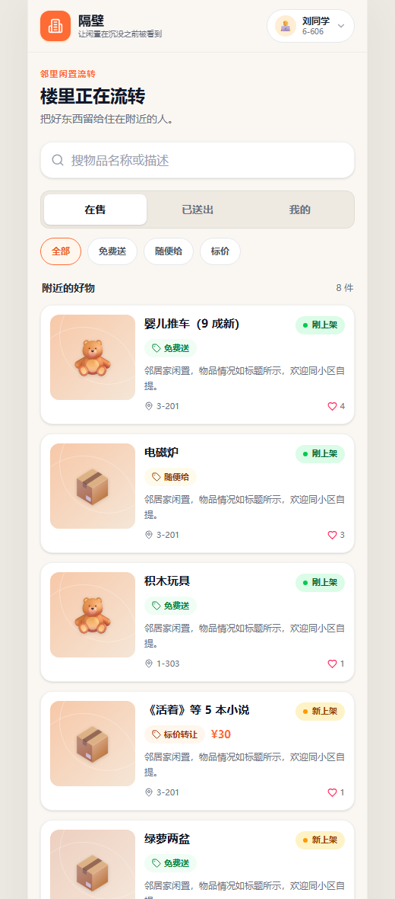
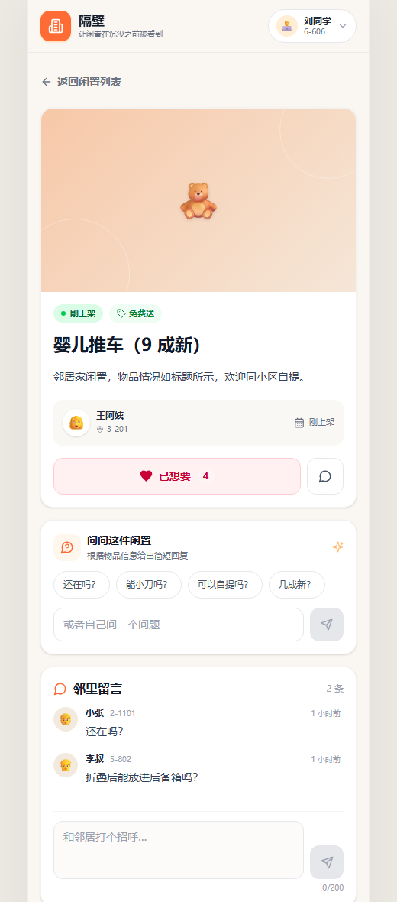
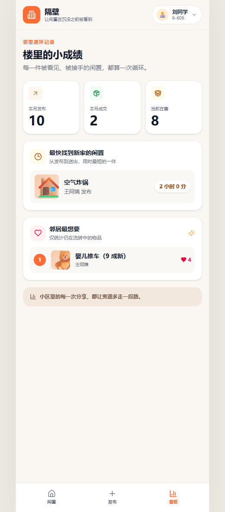

# 隔壁 · 楼里的闲置流转

> 让闲置物品，在被忘掉之前被看到。

一个给小区、楼栋内部用的轻量闲置流转 Web App。业主群里的东西沉得太快，真正需要的人还没看到就被刷走了 —— 隔壁想解决的就是这一件事。

**📹 [观看 4 分 48 秒讲解视频](video/out/演示.mp4)**（含 Demo、AI 能力演示、架构与取舍说明）

| 物品列表 | 物品详情 | 数据看板 |
|---|---|---|
|  |  |  |

---

## 功能

| 模块 | 说明 |
|---|---|
| **物品发布** | 名称、描述、交易方式（免费送 / 随便给 / 标价转让）；每件物品有**新鲜度**标识：一天以内「刚上架」、三天以内「新上架」、再久显示「已上架 N 天」 |
| **浏览与检索** | 卡片流按新鲜度倒序；按交易方式筛选；关键词搜索名称与描述；已送出物品归档保留、可查看不可操作 |
| **意向表达** | 点「想要」表达意向，发布者能看到谁想要；双方确认后发布者标记「已送出」，自动记录成交 |
| **公开留言板** | 围绕单件物品公开问答，避免同一个人被反复私聊问同样的事 |
| **数据看板** | 本月发布数 / 本月成交数 / 当前在售数；「最快被领走」与「最多人想要」两个榜单 |
| **大模型能力** | ① 智能定价建议 ② 描述文案优化 ③ 交易 FAQ 自动回复（把物品真实字段注入提示词） |

## 技术栈

| 层 | 选型 |
|---|---|
| 前端 | React 18 + Vite + TypeScript + Tailwind CSS v4 + react-router + lucide-react |
| 后端 | FastAPI（**全同步 `def`**）+ SQLAlchemy 2.0 声明式 + Pydantic v2 |
| 数据库 | SQLite（4 张表，5 个索引，4 条 CHECK 约束） |
| 大模型 | OpenAI 兼容接口（DeepSeek / 阿里云百炼均可，只换 `base_url` 与 `model`） |
| 请求 | 原生 `fetch` + 自写 20 行封装；**不引** axios / TanStack Query / 组件库 |

架构分层：`React + Vite` → *Vite 代理 `/api`* → `FastAPI` → `SQLAlchemy` → `SQLite`

前后端完全解耦：接口由 FastAPI 自动生成文档（`/docs`），可脱离前端直接自测；前端通过代理访问后端，不写死后端地址。

## 数据库设计

四张表：`users` / `items` / `wants` / `messages`。

几条刻意的设计决定：

- **成交信息折叠进 `items`**，不单独建表 —— 一件物品最多送出一次，1:1 拆表只会多一次关联查询、多一个状态不一致的机会；放在同一行还能直接用数据库约束「送出时间不早于发布时间」。
- **时间统一存 `epoch` 整数秒**，不用 `CURRENT_TIMESTAMP` —— 后者写入的是无时区标记的 UTC 文本，前后端各自加减小时就会错位。
- **新鲜度不入库** —— 它是发布时间的纯函数，落库必然与真实时间漂移。
- **四条规则写进数据库约束**，不靠前端自觉：

| 约束 | 业务含义 |
|---|---|
| `(trade_mode='priced') = (price IS NOT NULL)` | 标价必须有价；免费送/随便给不许有价 |
| `(status='given_away') = (given_away_at IS NOT NULL)` | 状态与送出时间同进同出 |
| `given_away_at IS NULL OR given_away_at >= created_at` | 送出不可能早于发布 |
| `given_to_user_id IS NULL OR status='given_away'` | 没送出就不该有接收人 |

完整 ER 图见 [`docs/er-diagram.md`](docs/er-diagram.md)。

## 快速开始

需要 **Python + uv** 和 **Node.js + npm**。

```bash
# 后端
cd backend
uv sync
uv run python -m app.seed --reset        # 初始化演示数据
uv run uvicorn app.main:app --reload --reload-dir app --port 8000

# 前端（另开一个终端）
cd frontend
npm install
npm run dev
```

- 前端：http://127.0.0.1:5173
- 接口文档（Swagger UI）：http://127.0.0.1:8000/docs

### 配置大模型（可选）

不配置也能跑：三个 AI 功能会自动回退到规则回复，主流程不受影响。

```bash
cd backend
cp .env.example .env
```

```ini
LLM_API_KEY=你的key
LLM_BASE_URL=https://dashscope.aliyuncs.com/compatible-mode/v1   # 或 https://api.deepseek.com
LLM_MODEL=qwen-plus                                              # 或 deepseek-chat
```

> `.env` 已在 `.gitignore` 中，不会进仓库。密钥只放后端，前端不接触。

## 接口

16 个接口，全部在 `http://127.0.0.1:8000/docs` 可视化自测。

```
身份    GET  /api/users          POST /api/users         GET  /api/me
物品    GET  /api/items          GET  /api/items/{id}    POST /api/items
        POST /api/items/{id}/give-away
互动    POST /api/items/{id}/wants      DELETE /api/items/{id}/wants
        GET  /api/items/{id}/wants
        GET  /api/items/{id}/messages   POST   /api/items/{id}/messages
看板    GET  /api/stats
AI      POST /api/llm/price-suggest     POST /api/llm/polish
        POST /api/llm/faq-reply
```

身份用请求头 `X-User-Id` 传递（读接口匿名放行，写接口校验）。

## 设计取舍

时间有限时做产品，砍掉什么和做了什么同样重要。

**砍掉的：**

1. **不做登录密码** —— 这是熟人小区的场景，输入名字就能进入，不需要信用体系。
2. **不做图片上传** —— 用按物品名称生成的品类封面代替，识别物品已经够用。
3. **不做分页，也不做编辑 / 删除 / 撤销送出** —— 数据量本来就小；让物品只能从「在售」走向「已送出」，减少状态分支。
4. **不做实时推送** —— 留言板已经解决了沟通问题。

**技术上主动做的判断：**

1. 成交信息折叠进物品表（理由见上）。
2. **后端统一用同步 `def`** —— 同步函数跑在线程池里，模型接口卡几十秒也只占一个线程，不会冻结整个事件循环。
3. **前端不引组件库和请求缓存框架** —— 卡片和表单用 Tailwind 与 React 手写，依赖少，出了问题更容易定位。

## 项目结构

```
├── backend/          FastAPI 应用
│   └── app/
│       ├── models.py     4 张表 + CHECK 约束
│       ├── schemas.py    Pydantic 出入参
│       ├── routers/      users / items / interactions / stats / llm
│       ├── services/     llm.py（统一调用 + 全套降级兜底）
│       ├── utils.py      新鲜度 / LIKE 转义 / 月边界
│       └── seed.py       演示数据
├── frontend/         React + Vite 应用
│   └── src/
│       ├── pages/        ListPage / DetailPage / PublishPage / DashboardPage
│       ├── components/   卡片、徽章、留言板、弹窗等
│       └── lib/          api 封装 / 身份 / 格式化
├── monitor/          自动验收工具（见下）
├── video/            讲解视频与生成流水线（见下）
├── docs/             ER 图 / 技术栈说明 / 视频逐字稿 / 截图
└── DEVELOPMENT.md    完整开发文档（规格、接口契约、边界情况、任务卡）
```

## 关于开发过程

这个项目主要用于验证 **AI Coding 实战能力**：需求拆解、技术选型、分阶段交付，都由 AI 协作完成。为了让"AI 说完成了"这句话变得可验证，配套搭了两样东西：

**① 自动验收工具 `monitor/verify.py`**（零依赖，仅标准库）

按验收项逐条真跑，输出客观的通过/失败，而不是采信"已完成"这个说法。它真的会做这些事：

- 往数据库插一条 `owner_id=999999` 的物品，**必须报外键错** —— 这是验证 SQLite `PRAGMA foreign_keys=ON` 是否真生效的唯一办法（不生效的话，DDL 里所有 `ON DELETE CASCADE` 都是摆设）
- 搜索 `%` 必须返回 0 条 —— 验证 LIKE 通配符转义，不转义会命中全部
- 校验 seed 数据前提：最快被领走的耗时、最想要的人数、三档新鲜度是否齐全
- 扫描前端全部源码，检查 API key 是否泄露

**② 讲解视频自动生成流水线 `video/`**

`build_audio.py`（配音 + 时间轴 + 字幕）→ `record2.js`（Playwright 按配音时长分段驱动浏览器录屏）→ `make_slides.js`（架构与取舍幻灯片）→ `assemble.py`（ffmpeg 合成）。

关键点是**音频先行**：先定稿配音、量出真实时长，再按它控制录制节奏。否则会出现"素材 123 秒配 288 秒旁白"的困境，硬拉长就变成 0.43 倍慢动作。

## 许可

个人项目，仅用于学习与求职作品展示。
